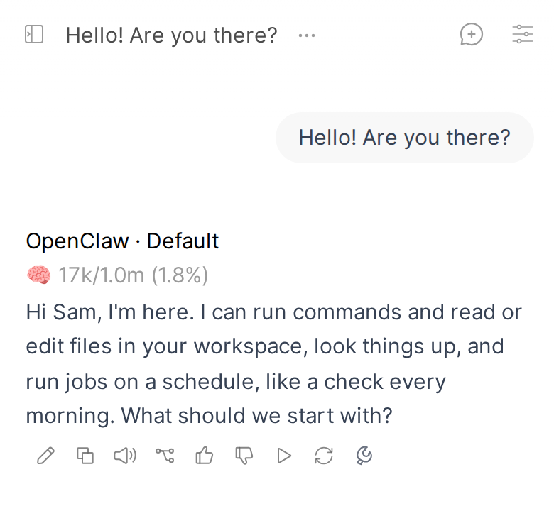
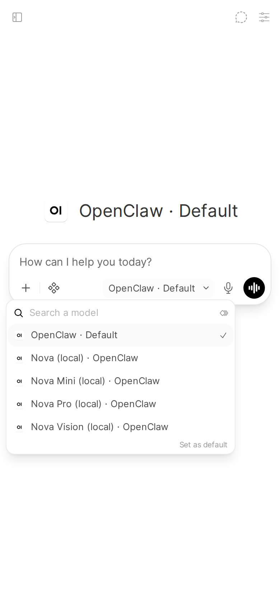
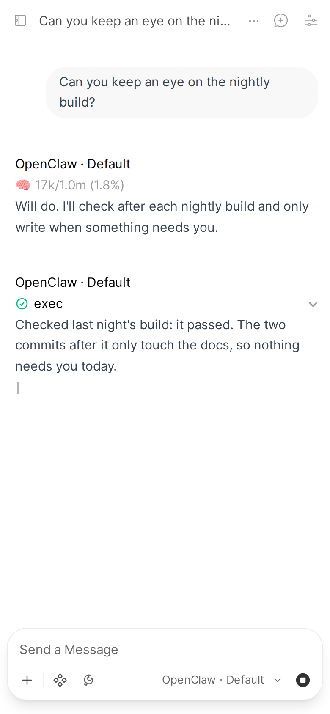

# OpenClaw for Open WebUI

[](https://github.com/Eliav2/openclaw-openwebui-integration/actions/workflows/ci.yml)
[](./LICENSE)
[](https://www.python.org/downloads/)

Chat with your OpenClaw agents from Open WebUI, on your phone, and watch them work: tool calls, questions and sub-agents show up as real UI, not text.

> [!NOTE]
> You need a running [OpenClaw Gateway](https://github.com/openclaw/openclaw). This connects it to Open WebUI; it is not an agent itself. No OpenClaw yet? [Install it first](https://docs.openclaw.ai).

<p align="center">
  <picture>
    <source media="(prefers-color-scheme: dark)" srcset="./docs/img/hero-tool-cards-dark.png">
    
  </picture>
</p>

## What you get

- **Live tool cards** for every command, read and search.
- **Questions as dialogs,** not walls of text.
- **Status:** context, rate limits, sub-agents.
- **Every Gateway model** in the model picker.
- **Cron jobs and sub-agent results** reply in the chat, live.
- **Survives restarts** and reconnects.

[Full feature list](./docs/features/index.md) · [In pictures](#in-pictures)

## Quick start

**1. On any machine that can reach Open WebUI** (needs [uv](https://docs.astral.sh/uv/)):

```bash
git clone https://github.com/Eliav2/openclaw-openwebui-integration
cd openclaw-openwebui-integration
uv run install.py install --wizard
```

The wizard asks for your Open WebUI admin login and the Gateway's address and token.

**2. On the Gateway host,** approve the new device. If step 1 ran on the Gateway host, the installer already did this for you.

```bash
openclaw devices list
openclaw devices approve <request-id>
```

**3. In Open WebUI,** pick **OpenClaw · Default** in the model picker and say hello.

You should see the installer end with:

```text
  ✓ Smoke test passed
  ✓ Route smoke test passed (...)
```

and the agent's first reply in the chat:

<p align="center">
  <picture>
    <source media="(prefers-color-scheme: dark)" srcset="./docs/img/first-reply-dark.png">
    
  </picture>
</p>

Something off? `uv run install.py healthcheck` re-checks the install and runs the smoke test again. See also [Troubleshooting](./docs/troubleshooting.md).

## Pick your path

- **Just try it** (5 min): the [Quick start](./docs/install/quickstart.md).
- **Everything** (10 min): the Quick start, then the [Status button](./docs/install/status-action.md), [thinking control](./docs/install/thinking-filter.md) and [agent skills](./docs/install/agent-skills.md).
- **No admin password given to a script** (10 min): the [manual install](./docs/install/manual.md).
- **Open WebUI and OpenClaw on different machines** (+5 min): [two hosts](./docs/install/two-hosts.md).

## Why I built this

I built this because I wanted OpenClaw on my phone.

OpenClaw's built-in chat UI was never somewhere I wanted to hold a long conversation, least of all on mobile. Open WebUI is polished and mobile-first. It feels like using ChatGPT or Claude, and I wanted that same experience for my own agents. So I built this, used it daily for a few months, and I'm now sharing it.

## This or `/v1`?

OpenClaw also ships an [OpenAI-compatible `/v1` endpoint](https://docs.openclaw.ai/gateway/openai-http-api#open-webui-quick-setup), and Open WebUI works with it out of the box. For many people that is the right answer. The difference is what each one carries:

| | `/v1` endpoint | This integration |
|---|---|---|
| Setup | One config flag | One install command |
| The agent's own tool calls | Not shown | Live tool cards |
| Sub-agents | Not shown | Listed, with a drawer each |
| Questions mid-run | No | Dialogs |
| Images and files the agent sends | No | Attached in the chat |

**`/v1` gives you the agent as a model. This gives you the agent as an agent.** [The full comparison](./docs/why.md)

## Versions

| | Minimum | Tested in CI |
|---|---|---|
| Open WebUI | 0.12.0 | 0.12.0 |
| OpenClaw Gateway | 2026.9.3 | 2026.9.3 |
| Python (inside Open WebUI) | 3.10 | 3.10 to 3.13 |

What an older release loses, and the test runs behind these numbers: [Versions](./docs/versions.md).

## In pictures

<p align="center">
  <picture>
    <source media="(prefers-color-scheme: dark)" srcset="./docs/img/tool-card-expanded-dark.png">
    
  </picture>
  <picture>
    <source media="(prefers-color-scheme: dark)" srcset="./docs/img/question-card-dark.png">
    
  </picture>
  <picture>
    <source media="(prefers-color-scheme: dark)" srcset="./docs/img/status-dialog-dark.png">
    
  </picture>
  <picture>
    <source media="(prefers-color-scheme: dark)" srcset="./docs/img/model-picker-dark.png">
    
  </picture>
  <picture>
    <source media="(prefers-color-scheme: dark)" srcset="./docs/img/agent-turn-dark.png">
    
  </picture>
  <picture>
    <source media="(prefers-color-scheme: dark)" srcset="./docs/img/reload-mid-reply-dark.png">
    
  </picture>
</p>
<p align="center"><sub>The list under "What you get", in order: a tool card opened, a question mid-reply, the Status dialog, the model picker, a cron reply in an open chat, and a reply after a page reload. The rate limits are sample data. Every feature's own screenshot is on its page in the <a href="./docs/features/index.md">feature list</a>.</sub></p>

## Docs

**Install**
- [Quick start](./docs/install/quickstart.md): from nothing to the first reply, with a check at each step
- [The installer](./docs/install/installer.md): the wizard, flags, updates and what `install` does
- [Manual install](./docs/install/manual.md), [device pairing](./docs/install/pairing.md), [two hosts](./docs/install/two-hosts.md)
- [Status button](./docs/install/status-action.md), [thinking control](./docs/install/thinking-filter.md), [agent skills](./docs/install/agent-skills.md)
- [Update and uninstall](./docs/install/update-uninstall.md)

**Use**
- [Features](./docs/features/index.md): chat, questions, status, sessions and models, replies from the agent, reliability
- [Configuration](./docs/configuration.md): every setting of the three functions

**Fix**
- [Troubleshooting](./docs/troubleshooting.md): symptoms, logs, what to put in a bug report
- [Versions](./docs/versions.md)

**Contribute**
- [Architecture](./docs/architecture.md) and [development](./docs/development.md)
- [All docs](./docs/index.md), also the starting point for agents

## Security, license, thanks

- **Security:** the integration drives your agent with its full privileges, so anyone who can chat with it can too. Read [Security](./docs/security.md) before you open Open WebUI to others, and report issues as [SECURITY.md](./SECURITY.md) describes.
- **License:** MIT, see [LICENSE](./LICENSE).
- **Thanks** to [cfullelove's gist](https://gist.github.com/cfullelove/7c6fa74e16d0a8f355e6d5ddb6d8e5fb), the proof of concept this grew from, and to [Open WebUI](https://openwebui.com/) and [OpenClaw](https://github.com/openclaw/openclaw).
