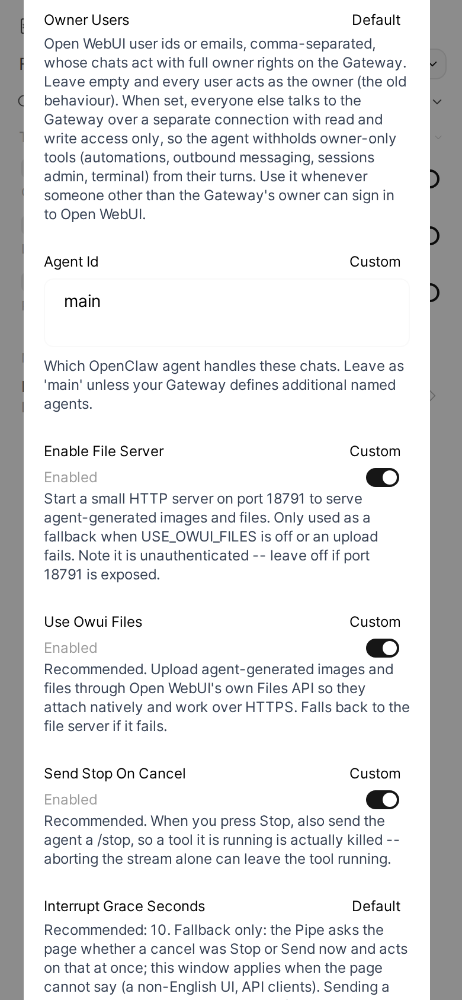

Every setting (valve) of the three functions, with its type, default and what it does. Generated from the code by `python3 build.py --all`; do not edit by hand.

Applies to: Pipe, Action, Filter

Set them in Open WebUI: **Admin Panel > Functions >** the function **> Valves** (the gear). The installer rewrites the connection valves on every run ([which ones](./install/installer.md#valves-the-installer-sets)) and keeps the rest. Changes apply on the next message, with no restart.

## Pipe

File: `openclaw_pipe.py`.

### GATEWAY_URL

Type: `str`. Default: `localhost:18789`.

Required. Your OpenClaw Gateway as host:port -- no http:// or ws:// prefix. Example: 192.168.1.10:18789. It must be reachable from the Open WebUI backend, which is not necessarily the same network as your browser.

### GATEWAY_TOKEN

Type: `str`. Default: empty.

Required. The Gateway API token: the value of `gateway.auth.token` in your OpenClaw config. Ask whoever runs the Gateway if you don't manage it yourself.

### DEVICE_IDENTITY

Type: `str`. Default: empty.

(Advanced -- normally leave empty.) Ed25519 device identity JSON. The pipe generates one on first connect and persists it in STATE_DIR. Set this only to import an already-approved identity, or to make the companion Status Action reuse this exact device instead of raising a second pairing request.

### STATE_DIR

Type: `str`. Default: `/data/openclaw-bridge`.

Directory inside the Open WebUI container where the device identity and Gateway token are stored. Must survive restarts: if it is not writable the pipe silently falls back to /tmp, and you will be asked to approve the device again after every restart.

### OWNER_USERS

Type: `str`. Default: empty.

Open WebUI user ids or emails, comma-separated, whose chats act with full owner rights on the Gateway. Leave empty and every user acts as the owner (the old behaviour). When set, everyone else talks to the Gateway over a separate connection with read and write access only, so the agent withholds owner-only tools (automations, outbound messaging, sessions admin, terminal) from their turns. Use it whenever someone other than the Gateway's owner can sign in to Open WebUI.

### AGENT_ID

Type: `str`. Default: `main`.

Which OpenClaw agent handles these chats. Leave as 'main' unless your Gateway defines additional named agents.

### ENABLE_FILE_SERVER

Type: `bool`. Default: `True`.

Start a small HTTP server on port 18791 to serve agent-generated images and files. Only used as a fallback when USE_OWUI_FILES is off or an upload fails. Note it is unauthenticated -- leave off if port 18791 is exposed.

### USE_OWUI_FILES

Type: `bool`. Default: `True`.

Recommended. Upload agent-generated images and files through Open WebUI's own Files API so they attach natively and work over HTTPS. Falls back to the file server if it fails.

### SEND_STOP_ON_CANCEL

Type: `bool`. Default: `True`.

Recommended. When you press Stop, also send the agent a /stop, so a tool it is running is actually killed -- aborting the stream alone can leave the tool running.

### INTERRUPT_GRACE_SECONDS

Type: `float`. Default: `10.0`.

Recommended: 10. Fallback only: the Pipe asks the page whether a cancel was Stop or Send now and acts on that at once; this window applies when the page cannot say (a non-English UI, API clients). Sending a message while the agent is working (Open WebUI's Send now, or sending with the message queue off) stops the current response. With this set, the agent's run is kept alive instead: the new reply first shows the rest of the running turn, then answers your message. A plain Stop with no new message still stops the run after this many seconds. 0 stops immediately, as before.

### AUTO_SEND_WHILE_RUNNING

Type: `bool`. Default: `True`.

Recommended. A message you send while the agent is working goes into the chat at once, instead of waiting in Open WebUI's queue above the composer for you to click Send now. The running reply is not stopped: the agent finishes its current work, then answers your message. Off: Open WebUI queues it, and it is sent when the reply ends or when you click Send now.

### OWUI_BASE_URL

Type: `str`. Default: `http://127.0.0.1:8080`.

Open WebUI's own base URL, resolved by the Open WebUI backend itself and not by your browser. The default is correct for a standard single-container install; change it only if Open WebUI cannot reach itself at 127.0.0.1:8080.

### OWUI_API_KEY

Type: `str`. Default: empty.

(Optional.) Only needed if media uploads fail with an auth error -- the pipe normally reuses your own login token.

### FILE_SERVER_BASE_URL

Type: `str`. Default: `http://localhost:18791`.

Legacy fallback only: base URL of the built-in media file server, used when USE_OWUI_FILES is off or an upload fails. The browser resolves this URL, not OWUI, so the default only works when you browse OWUI from the same host. Point it at an address your browser can reach if you depend on this fallback.

### DEFAULT_MODEL

Type: `str`. Default: empty.

Model used when you pick 'OpenClaw · Default'. Leave empty to use the agent's own configured model. The dropdown lists models discovered from your Gateway; before the first successful connection it shows a built-in example list that may not match your Gateway.

### MAX_MODELS

Type: `int`. Default: `30`.

Maximum number of models to show in the selector.

### AUTO_TITLE

Type: `bool`. Default: `True`.

Auto-generate a chat title after the first exchange (like native OWUI). Uses a fast model; best-effort, non-blocking.

### COMPOSER_STATUS_BUTTON

Type: `bool`. Default: `True`.

Add an OpenClaw 'Status' button to the composer row of OpenClaw chats (it opens the same dialog as the Status Action's message button, so that Action must be installed). Installed into the page at the start of each turn and when a tab opens an OpenClaw chat. Turn off to stop delivering it; an already open tab keeps it until reload.

### TITLE_GEN_AGENT_ID

Type: `str`. Default: `title-gen`.

Agent id used for background chat-title generation. It must exist on the Gateway (default 'title-gen'); if it does not, titles are silently skipped. Kept separate from AGENT_ID so title generation never queues behind your conversation.

## Status Action

File: `openclaw_status_action.py`.

The Action reuses the Pipe's Gateway connection when the Pipe has one. These valves are its own connection's settings, for when it has to open one: copy them from the Pipe's valves.

### GATEWAY_URL

Type: `str`. Default: `localhost:18789`.

Copy this exactly from the Pipe's valves. Gateway as host:port, no http:// or ws:// prefix, e.g. 192.168.1.10:18789. Used only when this Action has to open its own connection instead of reusing the Pipe's.

### GATEWAY_TOKEN

Type: `str`. Default: empty.

Copy this exactly from the Pipe's valves. The value of `gateway.auth.token` in your OpenClaw config. Used only for the fallback connection.

### DEVICE_IDENTITY

Type: `str`. Default: empty.

Copy this exactly from the Pipe's valves -- do not leave it empty if the Pipe has one. It is what lets a fallback connection be recognised as the same already-approved device instead of raising a second pairing request.

### STATE_DIR

Type: `str`. Default: `/data/openclaw-bridge`.

Copy this exactly from the Pipe's valves. It is how a fallback connection finds the Pipe's persisted device token on disk without re-pairing.

### AGENT_ID

Type: `str`. Default: `main`.

Copy this exactly from the Pipe's valves -- the same OpenClaw agent the Pipe routes chats to.

### CONTROL_UI_URL

Type: `str`. Default: empty.

The address you open the OpenClaw Control UI at, e.g. https://openclaw.example.com. When set, the Status dialog and the sub-agent drawer link to the session in it. Empty: no link.

## Thinking filter

File: `openclaw_thinking_filter.py`.

### priority

Type: `int`. Default: `0`.

Filter execution order. Lower runs earlier.

### override_advanced_params

Type: `bool`. Default: `True`.

When on, the level picked here wins over Open WebUI's own Advanced Params reasoning effort. Turn it off to let Advanced Params win and use this toggle only to enable thinking.

### level

Type: `str`. Default: `default`. Per user: each user sets it in **Chat Controls > Valves**, from only the levels your models support ([Thinking control](./install/thinking-filter.md)).

How hard the agent thinks before answering. 'default' sends nothing and leaves the agent's own configured level alone. Levels a model does not support are clamped down, and the chat says so.
