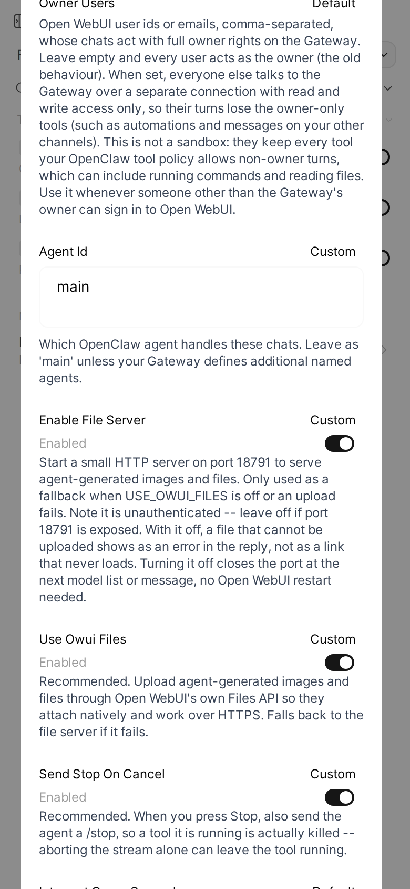

# Configuration

Every setting (valve) of the functions, with its type, default and what it does. Generated from the code by `python3 build.py --all`; do not edit by hand.

Applies to: Pipe, Action, Web Push (event function)

Set them in Open WebUI: **Admin Panel > Functions >** the function **> Valves** (the gear). The installer rewrites the connection valves on every run ([which ones](./install/installer.md#valves-the-installer-sets)) and keeps the rest. Changes apply on the next message, with no restart.

## Pipe

File: `openclaw_pipe.py`.

### GATEWAY_URL

Type: `str`. Default: `localhost:18789`.

Required. Your OpenClaw Gateway as host:port, for example 192.168.1.10:18789. Use a wss:// prefix for a Gateway behind a TLS proxy, for example wss://gateway.example.ts.net (port 443 unless you give one). A ws:// or http:// prefix is accepted and means the same as none. It must be reachable from the Open WebUI backend, which is not necessarily the same network as your browser.

### GATEWAY_TOKEN

Type: `str`. Default: empty.

Required. The Gateway API token: the value of `gateway.auth.token` in your OpenClaw config. Ask whoever runs the Gateway if you don't manage it yourself.

### DEVICE_IDENTITY

Type: `str`. Default: empty.

(Advanced -- normally leave empty.) Ed25519 device identity JSON. The pipe generates one on first connect and persists it in STATE_DIR. Set this only to import an already-approved identity, or to make the companion Status Action reuse this exact device instead of raising a second pairing request.

### STATE_DIR

Type: `str`. Default: `/data/openclaw-bridge`.

Directory inside the Open WebUI container where the device identity and Gateway token are stored. Must survive restarts: if it is not writable the pipe silently falls back to /tmp, and you will be asked to approve the device again after every restart.

### OWNER_USERS

Type: `str`. Default: empty.

Open WebUI user ids or emails, comma-separated, whose chats act with full owner rights on the Gateway. Leave empty and every user acts as the owner (the old behaviour). When set, everyone else talks to the Gateway over a separate connection with read and write access only, so their turns lose the owner-only tools (such as automations and messages on your other channels). This is not a sandbox: they keep every tool your OpenClaw tool policy allows non-owner turns, which can include running commands and reading files. Use it whenever someone other than the Gateway's owner can sign in to Open WebUI.

### AGENT_ID

Type: `str`. Default: `main`.

Which OpenClaw agent handles these chats. Leave as 'main' unless your Gateway defines additional named agents.

### ENABLE_FILE_SERVER

Type: `bool`. Default: `True`.

Start a small HTTP server on port 18791 to serve agent-generated images and files. Only used as a fallback when USE_OWUI_FILES is off or an upload fails. Note it is unauthenticated -- leave off if port 18791 is exposed. With it off, a file that cannot be uploaded shows as an error in the reply, not as a link that never loads. Turning it off closes the port at the next model list or message, no Open WebUI restart needed.

### USE_OWUI_FILES

Type: `bool`. Default: `True`.

Recommended. Upload agent-generated images and files through Open WebUI's own Files API so they attach natively and work over HTTPS. Falls back to the file server if it fails.

### SEND_STOP_ON_CANCEL

Type: `bool`. Default: `True`.

Recommended. When you press Stop, also send the agent a /stop, so a tool it is running is actually killed -- aborting the stream alone can leave the tool running.

### INTERRUPT_GRACE_SECONDS

Type: `float`. Default: `10.0`.

Recommended: 10. Fallback only: the Pipe asks the page whether a cancel was Stop or Send now and acts on that at once; this window applies when the page cannot say (a non-English UI, API clients). Sending a message while the agent is working (Open WebUI's Send now, or sending with the message queue off) stops the current response. With this set, the agent's run is kept alive instead: the new reply first shows the rest of the running turn, then answers your message. A plain Stop with no new message still stops the run after this many seconds. 0 stops immediately, as before.

### AUTO_SEND_WHILE_RUNNING

Type: `bool`. Default: `True`.

Recommended. A message you send while the agent is working goes into the chat at once, instead of waiting in Open WebUI's queue above the composer for you to click Send now. The running reply is not stopped: the agent finishes its current work, then answers your message. Off: Open WebUI queues it, and it is sent when the reply ends or when you click Send now.

### OWUI_BASE_URL

Type: `str`. Default: `http://127.0.0.1:8080`.

Open WebUI's own base URL, resolved by the Open WebUI backend itself and not by your browser. The default is correct for a standard single-container install; change it only if Open WebUI cannot reach itself at 127.0.0.1:8080.

### OWUI_API_KEY

Type: `str`. Default: empty.

(Optional.) Only needed if media uploads fail with an auth error -- the pipe normally reuses your own login token.

### FILE_SERVER_BASE_URL

Type: `str`. Default: `http://localhost:18791`.

Legacy fallback only: base URL of the built-in media file server, used when USE_OWUI_FILES is off or an upload fails. The browser resolves this URL, not OWUI, so the default only works when you browse OWUI from the same host. Point it at an address your browser can reach if you depend on this fallback.

### DEFAULT_MODEL

Type: `str`. Default: empty.

Model used when you pick 'OpenClaw · Default'. Leave empty to use the agent's own configured model. The dropdown lists models discovered from your Gateway; before the first successful connection it shows a built-in example list that may not match your Gateway.

### MAX_MODELS

Type: `int`. Default: `30`.

Maximum number of models to show in the selector.

### AUTO_TITLE

Type: `bool`. Default: `True`.

Auto-generate a chat title after the first exchange (like native OWUI). Uses a fast model; best-effort, non-blocking. Never replaces a title the user chose.

### PUBLISH_CHAT_FINISHED

Type: `bool`. Default: `False`.

Publish Open WebUI's 'chat.finished' event when an OpenClaw reply is saved, for every reply the Pipe writes (also cron, sub-agent and other agent turns), with source 'openclaw-pipe'. Event functions (such as a push notifier), event webhooks and notification targets receive it. Open WebUI's own 'chat.finished' still fires when the chat request ends, which for OpenClaw can be before the reply does, so a consumer that gets both should keep this one. A user with an Open WebUI notification target (Settings > Notifications) that has 'chat.finished' on gets both for a reply to a chat message, so two notifications; a reply an agent started (cron, sub-agent, sessions_send) has no chat request and gets only this one. The event's data holds the full reply text in 'message'.

### COMPOSER_STATUS_BUTTON

Type: `bool`. Default: `True`.

Add an OpenClaw 'Claw' button to the composer row of OpenClaw chats (it opens the same dialog as the Status Action's message button, so that Action must be installed). Installed into the page at the start of each turn and when a tab opens an OpenClaw chat. Turn off to stop delivering it; an already open tab keeps it until reload.

### CHANNEL_THREAD_DEBOUNCE_S

Type: `float`. Default: `15`.

Channels: after a new message in a thread the agent follows, wait this many seconds for more before deciding whether to answer, so a burst of messages gets one reply. 0: decide at once.

### CHANNEL_THREAD_IDLE_HOURS

Type: `float`. Default: `24`.

Channels: stop following a thread after this many hours without a message. A new mention follows it again.

### CHANNEL_CONTEXT_LIMIT

Type: `int`. Default: `50`.

Channels: at most this many messages go to the agent with one turn (the newest ones); the turn says how many were left out.

### LIVE_VIEW_URL

Type: `str`. Default: empty.

(Optional.) Show the agent's browser live inside a reply: when a reply first uses a browser tool, this URL is added to it as an embed. {chat_id} and {message_id} are replaced with the chat's and the reply's ids. It needs a service that serves such a page for the agent's browser. Empty: off.

### LIVE_VIEW_TOOLS

Type: `str`. Default: `^browser\b|^(?:\S*openclaw\S*|\$\{?\w+\}?)\s+browser\s+(?:--?\S+\s+)*(?:open|navigate|goto|click|type|press|fill|hover|scroll|screenshot|snapshot|evaluate|tabs?|focus|close|start)\b(?!.*\s--help\b)|^(?:\S*/)?(?:chromium(?:-browser)?|google-chrome(?:-stable)?|chrome)(?=\s|$)(?!.*\s--(?:version|help)\b)|^(?:(?:npx|bunx|pnpm\s+(?:dlx|exec)|bun\s+x)\s+(?:-\S+\s+)*)?playwright\s+(?:test|screenshot|open|codegen)\b|^uv\s+run\b.*--with[ =]playwright\b`.

Which tool calls count as browser use for LIVE_VIEW_URL: a regular expression, case-insensitive, searched in the tool's name and in each command of its `command` argument (from the command word on, so a word inside a quoted string, a heredoc or a file being written never counts). The default takes the browser tool, `openclaw browser` commands (how the agent drives its browser through exec), Chromium or Chrome started as a command, Playwright's CLI running its open, codegen or screenshot command or its runner, and `uv run --with playwright`. Add your own wrapper scripts here if your agent starts a browser through one: they are matched the same way, in command position.

### LIVE_VIEW_USERS

Type: `str`. Default: empty.

Open WebUI user ids or emails, comma-separated, whose replies get LIVE_VIEW_URL. Empty: everyone's, once LIVE_VIEW_URL is set.

### CONTROL_LINK_PATTERN

Type: `str`. Default: empty.

(Optional.) A link the agent hands you to take over from it, such as a page that lets you drive its browser for a login or a CAPTCHA: a regular expression searched in each tool result. Its first match, an http(s) URL, is added to the reply as a "Take control" link that opens in a new tab, once per link and chat. Empty: off.

### SYNC_SLASH_COMMANDS

Type: `bool`. Default: `False`.

Offer the Gateway's slash commands in Open WebUI's / menu: each becomes a Workspace Prompt that every user can see, kept in sync with the Gateway. A prompt you made yourself is never changed: a command with the same name is skipped. Turning this off deletes the prompts the sync made. The Gateway still refuses an owner-only command from a user who is not the owner.

### SLASH_COMMANDS_EXCLUDE

Type: `str`. Default: `stop,new,reset,model,status,compact`.

Slash commands not to offer as prompts, comma-separated. Of the defaults, Open WebUI runs /status, /compact and /model itself when you send them alone, so they never reach OpenClaw; /stop has the Stop button; /new and /reset would reset the session under an open chat.

### PROMPT_PREFIX

Type: `str`. Default: empty.

Put this in front of every synced prompt's command, for example oc_ to show /oc_status and keep them together in the menu. Empty: the command is the Gateway's own name.

### SYNC_INTERVAL_MIN

Type: `int`. Default: `30`.

How often, in minutes, to check the Gateway for changed commands, at most. A check is one small request, made in the background after a message. A page load and the Gateway's own change notice also start one.

### TITLE_GEN_AGENT_ID

Type: `str`. Default: `title-gen`.

Agent id used for background chat-title generation. It must exist on the Gateway (default 'title-gen'); if it does not, titles are silently skipped. Kept separate from AGENT_ID so title generation never queues behind your conversation.

### thinking_default

Type: `str`. Default: `default`. Per user: each user sets it in **Valves** (Open WebUI 0.13: Model controls, next to the model's name; 0.12: Chat Controls) ([Thinking level](./features/chat.md#thinking-level)).

Your thinking level for chats that set none in Advanced Params (Reasoning Effort). 'default' sends nothing and keeps the model's own level. A level a model does not support is clamped down, and the chat says so.

## Status Action

File: `openclaw_status_action.py`.

The Action reuses the Pipe's Gateway connection when the Pipe has one. These valves are its own connection's settings, for when it has to open one: copy them from the Pipe's valves.

### GATEWAY_URL

Type: `str`. Default: `localhost:18789`.

Copy this exactly from the Pipe's valves. Gateway as host:port, e.g. 192.168.1.10:18789, or with a wss:// prefix for a Gateway behind a TLS proxy. Used only when this Action has to open its own connection instead of reusing the Pipe's.

### GATEWAY_TOKEN

Type: `str`. Default: empty.

Copy this exactly from the Pipe's valves. The value of `gateway.auth.token` in your OpenClaw config. Used only for the fallback connection.

### DEVICE_IDENTITY

Type: `str`. Default: empty.

Copy this exactly from the Pipe's valves -- do not leave it empty if the Pipe has one. It is what lets a fallback connection be recognised as the same already-approved device instead of raising a second pairing request.

### STATE_DIR

Type: `str`. Default: `/data/openclaw-bridge`.

Copy this exactly from the Pipe's valves. It is how a fallback connection finds the Pipe's persisted device token on disk without re-pairing.

### AGENT_ID

Type: `str`. Default: `main`.

Copy this exactly from the Pipe's valves -- the same OpenClaw agent the Pipe routes chats to.

### CONTROL_UI_URL

Type: `str`. Default: empty.

The address you open the OpenClaw Control UI at, e.g. https://openclaw.example.com. When set, the Status dialog and the sub-agent drawer link to the session in it. Empty: no link.

## Web Push

File: `push/openclaw_web_push.py`.

The Web Push event function ([Push notifications](./install/web-push.md)). Its per-user valves (each device's subscription, muted chats and folders) are written by its page script and service worker, not by hand.

### VAPID_PRIVATE_KEY_FILE

Type: `str`. Default: `os.path.join(os.environ.get('DATA_DIR', '/app/backend/data'), 'web-push', 'vapid_private.pem')`.

Path, inside the Open WebUI container, of the VAPID private key (PEM). Kept in a file because valves are stored unencrypted by default.

### VAPID_SUBJECT

Type: `str`. Default: empty.

Contact the push services may use (mailto: or https: URL). Empty: Open WebUI's WEBUI_URL.

### TTL_SECONDS

Type: `int`. Default: `3600`.

How long a push service keeps a notification for a device that is offline.

### URGENCY

Type: `str`. Default: `normal`.

RFC 8030 Urgency: very-low, low, normal or high.

### PIPE_MODEL_PREFIXES

Type: `str`. Default: `openclaw_gateway.`.

Comma list of model id prefixes whose replies come from the OpenClaw Pipe (its function id plus a dot). For these, only the Pipe's own 'chat.finished' is sent. Turn on the Pipe's PUBLISH_CHAT_FINISHED.

### NOTIFICATION_ACTIONS

Type: `str`. Default: `reply,mute`.

The notification's buttons, in order: reply (a text field in the notification, sent as your message), read (marks the chat read), mute (this chat, 8 hours). Android Chrome shows the first two; iOS shows none.

### PREVIEW_CHARS

Type: `int`. Default: `0`.

Show the start of the reply (plain text, at most this many characters) in the notification. 0: off, the body says 'New reply'. The text shows on the lock screen and in the notification shade of every subscribed device.
