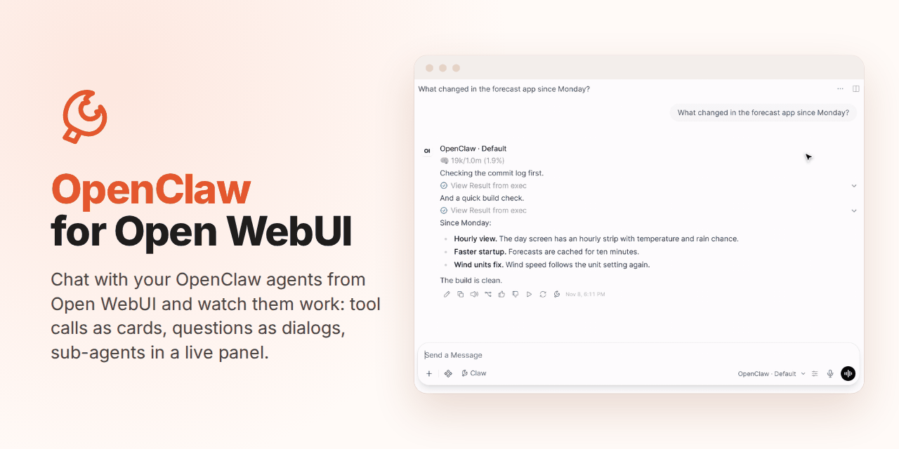

# Development

Editing the source fragments, rebuilding the artifacts, and running the tests.

## Building the artifacts

`openclaw_pipe.py` and `openclaw_status_action.py` are **built artifacts**, and so is
`docs/configuration.md`. Don't hand-edit them. Edit the fragments under `src/openclaw_pipe_pkg/`, then
rebuild:

```bash
python3 build.py --all        # rebuild every artifact and docs/configuration.md
python3 build.py --check-all  # verify every committed artifact matches src/ (CI drift guard)

python3 build.py              # rebuild openclaw_pipe.py only
python3 build.py --action     # rebuild openclaw_status_action.py only
python3 build.py --check      # drift guard, Pipe only
python3 build.py --check-action  # drift guard, Action only
```

Each single-artifact invocation builds exactly one file, and several fragments
feed **both** artifacts, so prefer `--all` / `--check-all`. Using the
Pipe-only `--check` after editing `action.py` reports "no drift" while the
committed Action artifact is stale.

Why a hand-written concatenation instead of a bundler: OWUI reads a function
as a single flat `.py` file, using the frontmatter docstring for metadata and
introspecting a top-level `Pipe`/`Action` class directly, most bundlers
break one or both of those.

### When your change breaks streaming

| Symptom | Likely cause |
|---|---|
| Text appears all at once instead of streaming | A code path in the Pipe uses `return` instead of `yield`. The Pipe is an async generator: Open WebUI streams each chunk only as it is yielded (see [Architecture](./architecture.md#how-it-works)). Check your code. |

User-facing problems are in [Troubleshooting](./troubleshooting.md).

### Docs

| Doc | What it covers |
|-----|----------------|
| [`docs/rehydration-persistence.md`](./rehydration-persistence.md) | How Open WebUI 0.12 keeps an assistant message mid-run, so a client reconnecting mid-turn sees the answer so far, and why a done:false message cannot be written. Read this before changing anything about streaming or persistence. |
| [`docs/design/ask-user-modal.md`](./design/ask-user-modal.md) | Design spec for a tool-call-based ask-user flow. **Not implemented as written**: see the banner at the top; the shipped approach intercepts `OpenClaw needs input:` text. |

### Running the tests

```bash
uv run --with-requirements requirements-dev.txt pytest -q
```

This is green on a fresh clone with no setup. `requirements-dev.txt` pins
pydantic, cryptography and websockets to the versions Open WebUI itself locks,
because the artifacts run inside Open WebUI's interpreter.

Most of the suite (`tests/test_build.py` and every `tests/test_*_unit.py`) is pure unit
tests with no external dependencies. What the suites share lives in two modules pytest
does not collect: `tests/_test_stubs.py` (stand-ins for websockets, cryptography and
pydantic) and `tests/_test_helpers.py` (`run_page` for the fake-DOM page scripts,
`RecordingEmitter`, `action_gateway`, `fake_owui`/`owui_modules`, `FakeSio`). `tests/fixtures/test_fixture_owui_streaming_handler.py`
is not a suite, it's a verbatim copy of Open WebUI's streaming handler, used
as a fixture to pin tool-card rendering against the real thing.

`e2e/test_e2e.py` and `e2e/test_browser_flows.py` skip unless `E2E_STACK=1`: it needs the stack that
`e2e/start_stack.sh` brings up (see E2E below). Two fixture checks in
`tests/test_pipe_unit.py` (`-k installed_dist`) compare the Gateway source lines the
Pipe matches on with an installed OpenClaw: `$OPENCLAW_DIST`, else the global
npm install's. They skip when neither exists; the extractors that rewrite those
fixtures (`scripts/extract_openclaw_*.py --write`) default to the same dist.

### CI

Every push and PR runs `.github/workflows/ci.yml`. The E2E lanes run on every push to main and on a PR only when it can change what runs: a PR that touches only docs, Markdown, `tests/` (outside `tests/fixtures/`), the issue templates, or Python comments and docstrings skips them (`scripts/ci_scope.py`, job "Runtime scope"). Nothing requires an E2E check to merge, so a skipped lane blocks nothing.

| Job | What it guards |
|-----|----------------|
| Lint | `ruff` with correctness rules only (`ruff.toml`), run on the **built artifacts** rather than the fragments, so an undefined name is caught where Open WebUI would hit it. Also `shellcheck`, `actionlint`, and a parse check of the Gateway plugin. |
| Unit (py3.10 to 3.13) | Drift guard for every artifact, the unit suite (coverage reported on 3.11), and a load check that execs each artifact the way Open WebUI's plugin loader does. |
| OWUI handler fixture is current | `scripts/check_owui_fixture.py` compares the vendored `handle_responses_streaming_event` with Open WebUI's source: the copy the tests run against the pinned version (`--copy pinned`), and the next release's `_v<tag>` copy, or that same copy, against `OWUI_NEXT_REF` (`--copy next`). A stale copy is how the tool cards once vanished while the suite stayed green. `scripts/check_owui_frontend_fixture.py` does the same for the chat tab's live reducer (`applyResponseStreamEvent`, run with bun by the live-order tests). |
| Secret scan | gitleaks over the full history. |
| E2E | The whole stack, real everywhere except the model (below), on the pinned Open WebUI and OpenClaw, which are what the live install runs. |
| E2E oldest | The same suite on the oldest supported OpenClaw (`OPENCLAW_OLDEST_VERSION`), with the pinned Open WebUI. Reports, never blocks. Removed when the documented minimum moves up (ELI-356). |

**E2E** (`.github/workflows/e2e.yml`, `e2e/`): starts a deterministic fake
OpenAI-compatible model (`e2e/fake_llm.py`), a real OpenClaw Gateway pointed at
it (with one test-only plugin, `e2e/agent-tool`: an `Agent` tool that answers
like Claude Code's, which the Gateway's own runtime does not have), and Open
WebUI in Docker; installs the Pipe and Action with
`uv run install*.py install` exactly as the README tells users to (device
pairing and the installer's smoke test included); then runs `e2e/test_e2e.py`
against it, and the installed-dist fixture checks against the Gateway it
installed. `e2e/test_browser_flows.py` then drives the same stack in Chromium
with Playwright, one test per user flow, asserting on what the page shows (the
browser helpers are `scripts/screenshots/capture.py`'s). Because the model is scripted, replies are
asserted exactly, the model that served a turn is read from the fake model's
request log (the stack's default, `e2e-default`, differs from the routed
`e2e-echo`), and a real tool call (`session_status`) is checked all the
way into the chat Open WebUI persisted, as a `function_call` with its matching
`function_call_output`. A third model, `e2e-think`, is the only reasoning one,
so the thinking level a turn picks shows in that request log as
`reasoning_effort`. Gateway, Open WebUI and model logs are uploaded as an
artifact on every run.

The E2E job runs as 4 jobs per lane, side by side, each on its own stack and
each running one shard of the tests (`e2e/shards.py`, picked by `E2E_SHARD`).
A new E2E test goes in a shard in the same PR: `tests/test_e2e_shards.py`, in
the Unit job, fails when a test is in no shard or in two, when the workflow's
matrix and the shards differ, and when a shard holds more than two of the
tests that crash the Gateway (a third crash on one stack waits up to 5 minutes
for the Gateway's crash-loop window). The openclaw download and Playwright's
Chromium are cached, keyed on their exact versions.

If Open WebUI logs `database is locked` during an E2E run, `e2e/conftest.py`
asks the database for its write lock from another process, waiting up to 10 s.
Still locked: it interrupts the running test and ends the run (exit code 3),
naming that test and the log line, since a lock that is never released
(ELI-205) would fail every later test at its timeout. Free: it was two writers
at once and the lock cleared; the run goes on, and its summary lists the line
under "Open WebUI database lock that cleared".

**Drop gates.** One Open WebUI bug still has a Pipe workaround: a cancelled
chat write that wedges SQLite (ELI-205, shielded by `turns.py`'s
`_uncancellable`). Its test produces the bug's precondition itself and runs
two ways: through the workaround (`shielded`), which must pass on any Open
WebUI, and without it (`raw`), which shows whether Open WebUI still needs
it. A new workaround for an upstream bug gets the same pair, with `raw`
marked strict `xfail` while the pinned release has the bug: when a release
fixes it, the `xfail` fails the run, the signal to drop the workaround.
Compat watch runs the same suites against `open-webui:latest`, so it shows
up there first.

The versions it runs against are pinned in `e2e/versions.env`. The pins stay on what the live install runs: move them in the PR that makes the code work with a new release, with the vendored fixtures re-extracted for it (the handler with `scripts/check_owui_fixture.py --ref <tag> --print-upstream`, the CSS class list with `scripts/owui_css.py dump`, the Stop button templates with `scripts/extract_owui_stop_button.py`) and the matching pins in `requirements-dev.txt`. The daily compat watch runs the suite against `open-webui:latest` and `openclaw@latest`, and checks the vendored handler against upstream's latest release and main, so a break shows up before a bump. To try an upcoming release in a PR, run the E2E workflow by hand (Actions > E2E > Run workflow) with the release in `openclaw_version` or `owui_image`; a release that needs a fixture of its own gets a `_v<tag>` copy next to it (dots as underscores, `_v0_13_0`), and setting `OWUI_NEXT_REF` in `e2e/versions.env` makes the fixture check match it too.

**Compat watch** (`.github/workflows/compat-watch.yml`, daily): the same E2E
stack against `open-webui:latest` and `openclaw@latest`, and the fixture
against upstream's latest release and `main`. A scheduled failure opens or
updates one tracking issue, so a breaking upstream release is visible before
the pins are bumped; the next green scheduled run closes it
(`scripts/compat_watch_issue.sh`).

**Screenshots and Demos** (`.github/workflows/screenshots.yml` and
`demos.yml`, by hand): the docs' images, from the E2E stack with the scripted
model serving real-looking scenes (`scripts/screenshots/scenes.json`; the
demos add `scripts/demos/demos.json`). `capture.py` takes the stills;
`scripts/demos/record.py` records each demo in `demos.json` with the DevTools
screencast at 2x, a drawn cursor, a ripple on each click and a badge for each
key, then encodes it with ffmpeg into a light GIF, 960 px wide, at most 15 s (a
demo that needs longer sets `max_seconds`) and 1 MB. Both fail when a page shows deny-listed text (words that give away a test
stack). A demo waits on what the page shows, never on time: a reply is done when
its text is stable and "Thinking…" is gone. Before committing a GIF, look at
frames from it (`ffmpeg -i x.gif -vf "select=not(mod(n\,40))" -vsync 0 f%02d.png`).

One recording is not made by CI: `docs/img/demos/live-browser.*`, the live view of the agent's browser
(docs/examples/live-browser-view.md). It needs a real agent, Google's real results and a live view
service behind a login, so it is a real chat on a real setup, recorded by hand and marked
`"manual": true` in `docs/img/media.json`. To record it again, on a machine where the Pipe's
`LIVE_VIEW_URL` is set for your account:

```sh
OWUI_URL=http://localhost:8080 OWUI_TOKEN=<your Open WebUI token> \
  uv run --with-requirements requirements-browser.txt --with imageio-ffmpeg==0.6.0 --with pillow \
  python scripts/demos/record_live.py record --work /tmp/live-browser --folder QA \
  --viewer-origin <the live view's origin> --viewer-header 'Name: value'   # its login, if it has one
python scripts/demos/record_live.py encode --work /tmp/live-browser --out docs/img/demos \
  --cut 6-27=3,27-49=4.5,57-95=2.5   # play the waiting stretches faster; the docstring says how
python3 scripts/media.py stamp --manual docs/img/demos/live-browser.{gif,mp4,webm}
```

The phone screenshot beside it, `docs/img/live-view-light.png`, comes from a second run of the same
request in a phone-sized page: `record_live.py still --work /tmp/live-view-still` (same options as `record`)
saves a PNG every 1.5 s while the live view is up, and you pick the frame with the results and the LIVE badge.
Check the corner of the viewer for the account's avatar and paint it white (it sits on a white header), then
`python3 scripts/media.py stamp --manual docs/img/live-view-light.png`.

`record` makes one new chat in your Open WebUI (put in the `--folder` folder, so it is
not among your own chats), types the request and keeps every frame. Look at the frames before encoding: the
run is real, so it varies. Take another run when the browser shows a signed-in account, a stray tab or
the viewer's own address. `encode` refuses a recording whose chat text shows a deny-listed word or an
email address, or whose frames show a Google account's avatar. Delete the chat afterwards.

The images can't go stale silently. `docs/img/media.json` records, for every
file under `docs/img`, fingerprints of the UI it shows: the composer's Claw
button and the Status icon (every frame), the Status dialog's scripts, and the
pinned Open WebUI image. When a pull request changes one of them, the docs unit
tests fail and list the files to record again. Run the two workflows with
`only` set to those names, put the files from their artifacts in `docs/img`,
then `uv run --with pillow scripts/media.py posters` if a README tile changed,
and `python3 scripts/media.py stamp <files>`. `stamp` refuses a file whose bytes
are the same as before the change. A screenshot of a state the change didn't
touch can come out identical: once you've recorded it again, pass `--same`.

**CodeQL** runs on Python, JavaScript and the workflows themselves.
**Dependabot** updates the GitHub Actions and the test tooling weekly.

To run the E2E stack on your own Linux machine (Docker, uv and a Node in the
range the pinned `openclaw` declares, `npm view openclaw@$OPENCLAW_VERSION
engines.node`; it installs `openclaw` globally and writes
`~/.openclaw/openclaw.json`, so use a throwaway VM or container, never a host running a real Gateway):

```bash
set -a; . e2e/versions.env; set +a
bash e2e/start_stack.sh        # last line is an `export ...` for the test env
export OWUI_URL=... OWUI_EMAIL=... OWUI_PASSWORD=... E2E_STACK=1   # paste it
uv run --with-requirements requirements-dev.txt pytest -v e2e/test_e2e.py
E2E_SHARD=2 uv run --with-requirements requirements-dev.txt pytest -v e2e/test_e2e.py   # one shard only
```

`bash e2e/start_stack.sh down` stops the fake model, the Gateway and its children, and the Open WebUI container this start created (it removes that container by the id recorded in `owui.id`, never by name). It reads the pid files in `E2E_LOG_DIR`, so give it the same `E2E_LOG_DIR`. It prints how many processes it stopped, and can be run twice:

```text
$ bash e2e/start_stack.sh down
stack down (5 processes stopped)
```

A start that fails halfway does that itself; `E2E_KEEP_ON_FAIL=1` keeps the half-started stack for a look.

Two things to know when a script or an agent tool starts the stack for you:
- Start it from a process that outlives the launching shell. A tool that kills its process group when a call ends also kills a `nohup` stack mid-start, silently; under systemd use `systemd-run --user --unit=<name> ...` and stop that unit when you are done.
- A wrapper that starts the script with a cleared environment (`env -i`) drops variables such as `E2E_KEEP_ON_FAIL`: put them in whatever env file the wrapper passes through.

---

## The docs site

`docs/` is the source of the docs site, [eliav2.github.io/openclaw-openwebui-integration](https://eliav2.github.io/openclaw-openwebui-integration/), built with [VitePress](https://vitepress.dev). Pages stay plain Markdown that also reads on github.com:

- Every page starts with a `# Title`, then its one-line summary.
- Images are `` tags, as the docs test requires. Callouts are GitHub's `> [!NOTE]` form, which VitePress renders too.
- Link to other pages by their relative `.md` path. A link to a file outside `docs/` (a function, `SECURITY.md`, `skills/`) works on GitHub as it is; the site points it at the file on GitHub.
- No Vue components or VitePress-only syntax in a page. The home page's hero and feature cards live in `docs/.vitepress/config.mts`, so `docs/index.md` stays a plain list on GitHub.
- A new page goes in the sidebar in `docs/.vitepress/config.mts`.

Run it locally with [bun](https://bun.sh):

```bash
bun install
bun run docs:dev     # live preview at http://localhost:5173/openclaw-openwebui-integration/
bun run docs:build   # what CI runs; fails on a dead internal link
```

The build also writes `llms.txt`, `llms-full.txt` and a raw `.md` next to every page, for agents. A demo is a GIF in the Markdown (what github.com shows); when `scripts/demos/record.py` wrote its MP4 and WebM next to it, the site plays that muted, looping video instead, at twice the GIF's resolution. The `Docs site` workflow builds every pull request that touches the docs and deploys `main` to GitHub Pages.

The repository's social preview, the card a link to the repo shows, is `docs/img/social-preview.png`. `scripts/social_preview.py` makes it from the hero demo's last frame; run it again after recording the hero, then upload the file in the repository's Settings > General > Social preview.



## Driving the integration over the API

You can send messages through the integration as if using the OWUI frontend by calling
the internal `/api/chat/completions` endpoint:

```bash
# 1. Sign in to get a token
TOKEN=$(curl -s -X POST http://localhost:8080/api/v1/auths/signin \
  -H "Content-Type: application/json" \
  -d '{"email":"admin@example.com","password":"***"}' \
  | python3 -c "import sys,json;print(json.load(sys.stdin)['token'])")

# 2. Send a message through the integration
curl -s -X POST http://localhost:8080/api/chat/completions \
  -H "Authorization: Bearer $TOKEN" \
  -H "Content-Type: application/json" \
  -d '{
    "model": "openclaw_gateway.default",
    "messages": [{"role": "user", "content": "Hello!"}],
    "stream": false
  }'
```

This triggers the full pipeline (pipe function, Gateway, agent, response)
and the conversation is saved to OWUI chat history automatically.
