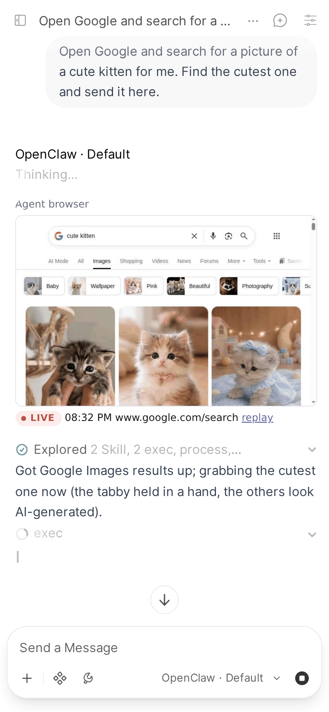

# Example: a live browser view

One way to use the [embed hook](../features/chat.md#embed-your-own-page-in-tool-using-replies): the agent's browser, live inside the reply that drives it.

Applies to: Pipe (`LIVE_VIEW_URL`, `LIVE_VIEW_TOOLS`, `LIVE_VIEW_USERS`).

> [!IMPORTANT]
> This is our own setup, shown as an example. The browser recorder and viewer on this page are a private service we run for our agents. They are not part of the Pipe, not in this repo and not provided. The Pipe only adds the address you give it to a reply; to get something like this, you build and run the service yourself.

The recording is made on the docs' demo stack, where a small stand-in page plays the part of our viewer and streams a real headless browser the same way.

## What it does

Our agents drive Chrome. A separate service on the Gateway host records that browser through the Chrome DevTools Protocol, works out which chat and reply drove each tab, and serves one page per reply. While the reply runs, the page plays the browser live; once the tab closes, it becomes a replay of the session.

## How it plugs into the Pipe

Three valves, set in the Pipe's valves:

- `LIVE_VIEW_URL`: the service's embed page, `https://<our viewer>/embed?chat={chat_id}&message={message_id}`. The service looks the reply up by those two ids.
- `LIVE_VIEW_TOOLS`: the default, plus the wrapper script our agents start their own private browsers with, except its runs marked as never recorded: those would have nothing to show.
- `LIVE_VIEW_USERS`: only our own account.

## If you build your own

What the Pipe needs from your service is small:

- An `https` page at the address in `LIVE_VIEW_URL`. Open WebUI only loads an embed that is a plain `http(s)` URL.
- It finds what to show from `{chat_id}` and `{message_id}` alone: the Pipe passes nothing else.
- It allows framing by your Open WebUI's origin (`Content-Security-Policy: frame-ancestors`).
- It has its own login. The frame is sandboxed, so the page sees no Open WebUI session, and a browser can show anything the agent opened.
