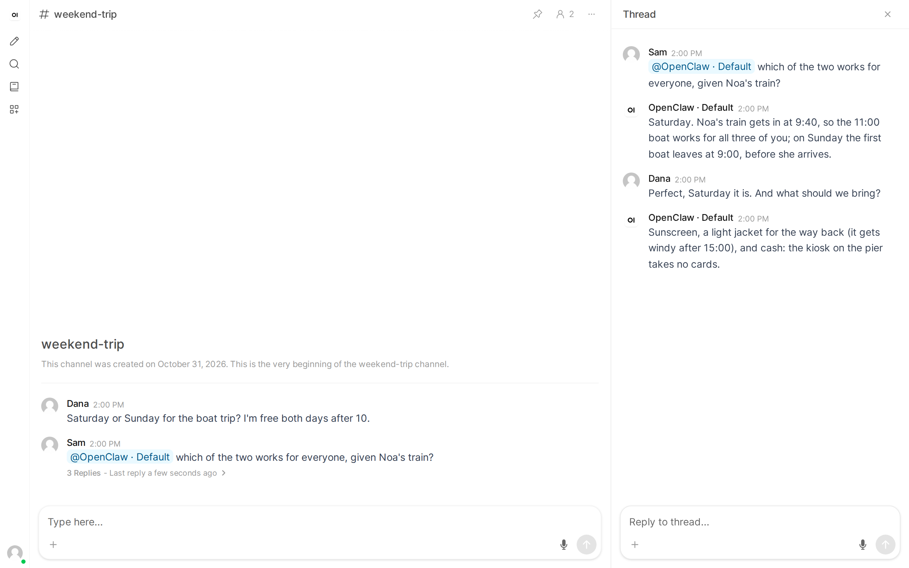

# Channels

Mention your agent in an Open WebUI channel and it answers in a thread. It then follows that thread: a message there that is meant for it gets an answer with no new mention, and the people in the thread can talk to each other without it chiming in.

Applies to: Pipe
Valves: `CHANNEL_THREAD_DEBOUNCE_S`, `CHANNEL_THREAD_IDLE_HOURS`, `CHANNEL_CONTEXT_LIMIT`, `OWNER_USERS`

## A mention opens a thread

Open WebUI sends a channel message to a model when it mentions the model (`@OpenClaw`) or replies to the model's message, and shows the answer in a thread on that message. That thread is one OpenClaw session, shared by everyone who writes in it: `agent:<AGENT_ID>:openwebui:channel:<channel id>:thread:<message id>`.

The turn tells the agent what it has not seen yet:

- **The first mention in a thread:** the channel's messages since the agent last looked at the channel, so it knows what was said before anyone mentioned it.
- **A mention in a thread it follows:** the thread's messages since its last turn there.

Each message is one line, `[HH:MM] Name (user id): text`, oldest first. At most [`CHANNEL_CONTEXT_LIMIT`](../configuration.md#channel_context_limit) messages go with one turn, the newest ones, and the first line says how many earlier ones were left out. The agent's own replies are not sent again, an edit to a message it already saw is not sent again, and a message deleted before its next turn never reaches it. Images and files in channel messages are not sent.

## Following the thread

After answering, the agent follows the thread. When someone writes there without mentioning it:

1. The Pipe waits [`CHANNEL_THREAD_DEBOUNCE_S`](../configuration.md#channel_thread_debounce_s) seconds (15 by default) for more messages, so a burst gets one decision and at most one answer.
2. It asks a short question of your Gateway's utility model: are the new messages meant for the agent? The question goes with the thread's last few messages (see [Privacy](#privacy)).
3. **Yes:** the agent gets a turn with the thread's new messages. It may still decide they were not for it and answer `[skip]`, and then nothing is posted. **No:** nothing runs, and the messages reach the agent with its next turn in that thread. **No utility model, or it is busy or fails:** the agent gets the turn and decides itself. The question is never asked twice.

When unsure, the agent stays silent. A mention always gets an answer.

A thread with no message for [`CHANNEL_THREAD_IDLE_HOURS`](../configuration.md#channel_thread_idle_hours) hours (24 by default) is no longer followed; a new mention there follows it again. The Pipe reads the channel only while it follows at least one thread, and only the followed threads' new messages.

An Open WebUI that runs several processes still posts one answer per message: the Gateway runs the turn for a message once, and only the process that started it posts the answer.

## Who has which rights

When [`OWNER_USERS`](../configuration.md#owner_users) is set, every turn in a channel runs without owner rights, the owner's own mentions too. A thread is shared, and a session whose turns alternate between owner and non-owner tools would start over on each change. So in channels the agent has no owner-only tools, such as automations and messages on your other channels, for anyone. Your one-to-one chats keep them. With `OWNER_USERS` empty every turn runs as the owner, as in chats. See [Owner users](./owner-users.md).

Without owner rights is not a sandbox: the agent can still run commands and read files, as far as your OpenClaw tool policy allows non-owner turns to. See [Security](../security.md#the-agents-privileges).

## Privacy

- **One agent.** Channel threads run on the Pipe's [`AGENT_ID`](../configuration.md#agent_id), the same agent as your chats. OpenClaw starts each of its sessions with that agent's workspace files, so a channel's turns can see the agent's private memory (for example `MEMORY.md`) and may quote it to everyone in the channel.
- **A thread is shared.** Everything the agent says in a thread, and everything it was told there, is visible to everyone who can read the thread.
- **The utility model sees the thread.** The relevance question sends the thread's last few messages to the model your Gateway uses as its utility model, which may be another provider than your agent's.

To keep your private memory out of channels, give channels their own agent: install a second copy of the Pipe with its own [`AGENT_ID`](../configuration.md#agent_id), an agent with its own workspace, and mention that copy's model in channels. Each copy follows its own threads.

## Limits

- The Pipe follows threads only while it is loaded: after Open WebUI restarts, it resumes following at its first reply (in any chat or channel).
- Only Open WebUI's thread mode is supported (`CHANNEL_MODEL_RESPONSE_MODE=thread`, the default).
- After updating from a version without channel threads, each channel's conversation with the agent starts fresh once: the earlier per-user channel sessions are left as they were and no longer used.
