# Chat

What a reply looks like in the chat: live text, the agent's tool calls as real cards, failures marked, images and files both ways, a usage line under each reply, and chat titles. Everything here works as soon as the Pipe is installed, except where a section says otherwise.

Applies to: Pipe (the thinking level also needs the thinking filter)
Valves: `USE_OWUI_FILES`, `OWUI_BASE_URL`, `OWUI_API_KEY`, `ENABLE_FILE_SERVER`, `FILE_SERVER_BASE_URL`, `AUTO_TITLE`, `TITLE_GEN_AGENT_ID`, `LIVE_VIEW_URL`, `LIVE_VIEW_TOOLS`, `LIVE_VIEW_USERS`, `CONTROL_LINK_PATTERN`, `SYNC_SLASH_COMMANDS`, `SLASH_COMMANDS_EXCLUDE`, `PROMPT_PREFIX`, `SYNC_INTERVAL_MIN`

## Streaming

Text appears token by token as the Gateway sends it, so a long answer starts showing at once instead of landing in one block at the end.

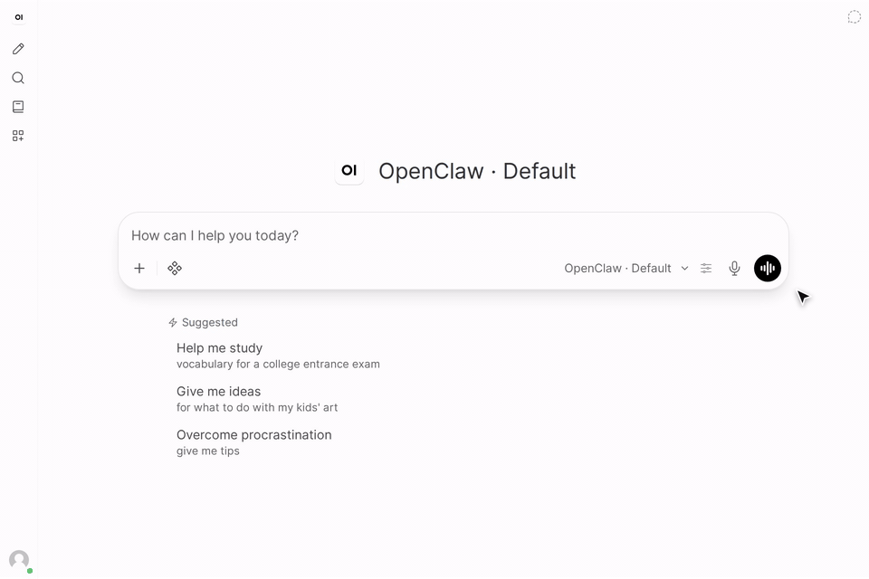

Two provider quirks are handled so you never see them:

- Some runtimes resend the whole reply as one final cumulative frame. The Pipe recognises text it has already shown and drops the repeat, so the answer is never printed twice.
- Other events carry their text as a whole item rather than as deltas. That text is shown too, not dropped.

Internal scaffolding never reaches the reply: the Sender provenance block (see [the metadata contract](../metadata-contract.md)) and the silent sentinels an agent uses to mean "say nothing" (`NO_REPLY`, `ANNOUNCE_SKIP`) are filtered out, also when the agent says one and then answers after all (a background task that reported later). A reply that ran tools and then said only a sentinel keeps its tool cards, with no text and no "no reply text" note.

Always on.

## Tool cards

Tool calls are sent as Responses-API output items, so Open WebUI draws them with its own two-phase tool card: a spinner while the tool runs, the result when it finishes. Nothing is hand-rolled HTML, so the cards match the rest of the UI and survive a reload.

Expand a card to see the arguments the agent passed and the result it got back. Arguments are capped at 3000 characters and results at 8000, so one huge tool result cannot bury the conversation.

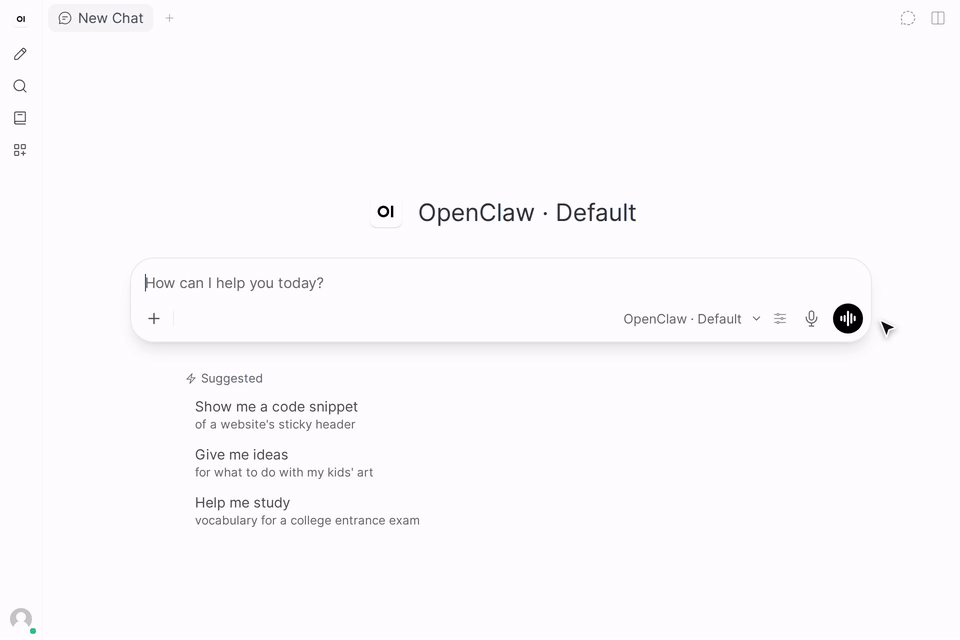

A call that arrives without a tool-call id still shows: it falls back to a Markdown `
` card rather than disappearing. The status row under the message says "Thinking..." for the whole run and does not repeat each call: the cards already show what is running, and Open WebUI saves every status change by rewriting the whole chat, so one per call made long chats slow.

Always on. On Open WebUI older than the minimum a card can keep spinning after its tool finished: see [Versions](../versions.md).

## Sub-agent cards

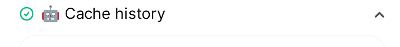

When the agent starts a sub-agent (`sessions_spawn`), its card is named after the sub-agent: 🤖 and the name the agent gave it, or the first sentence of its task, cut to 60 characters, when it gave none. Several sub-agents started in a row group as "Explored 🤖 Fly.io pricing, 🤖 Render pricing".

Expanded, the card shows the first three lines of the task, not the whole prompt, and one line of outcome: "Started: \<name\>", or "Not started" with the reason, in which case the card is marked failed like any other tool. The full task, and what the sub-agent does with it, are in its [drawer](./status.md#sub-agent-drawer).

A reply rebuilt from the transcript shows the same card.

Always on.

## Failed tools

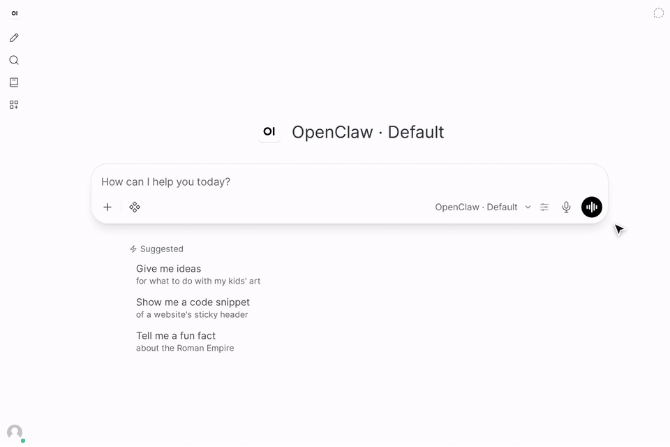

A tool call that fails gets Open WebUI's red X in place of the green check, and its card renamed to `<name> ❌`, the moment the result arrives, on any card, not only the last one. The mark is part of the saved message, so it is still there after a reload. The expanded output opens with a `❌ tool call failed` line, so the reason is visible once you open the card.

A tool that was announced but never returned, because the run was cancelled or crashed, is closed at the end of the reply with "(no result -- the run ended first)". When the run was cut by a restart and will continue, the note reads "(interrupted -- the reply continues when the run resumes)" instead. A card left spinning forever looks exactly like a hung UI, so it is never left that way.

Always on.

## Embed your own page in tool-using replies

A hook for a page you serve yourself. When a reply first makes a tool call that matches a pattern, the Pipe adds your page's address to that reply as an embed. Open WebUI shows it inside the message, under the reply, and keeps it with the message.

The Pipe ships no such page and no viewer: it only passes the address on. Without a service of your own behind that address, there is nothing to show.

- [`LIVE_VIEW_URL`](../configuration.md#live_view_url): your page's address, with `{chat_id}` and `{message_id}` where the chat's and the reply's ids go, for example `https://viewer.example.org/embed?chat={chat_id}&message={message_id}`. The two ids are all your service gets to know which reply it is showing.
- [`LIVE_VIEW_TOOLS`](../configuration.md#live_view_tools): which tool calls add it, a pattern searched in the tool's name and in the commands of its `command` argument, from the command word on. The default is a real browser launch: the `browser` tool, `openclaw browser` commands (how the agent drives its browser through exec), Chromium or Chrome started as a command, `playwright test`, `screenshot`, `open` or `codegen`, and `uv run --with playwright`. A browser word in a file the agent writes, a message, a search or a quoted string does not count. If your agent starts a browser through a script of its own, add the script to the pattern; it is matched the same way.
- [`LIVE_VIEW_USERS`](../configuration.md#live_view_users): limits it to some users.

The valves are named after the use the hook was built for, a live view of the agent's browser, but the page can be anything your service serves for a reply. See [our own setup as one example](../examples/live-browser-view.md).

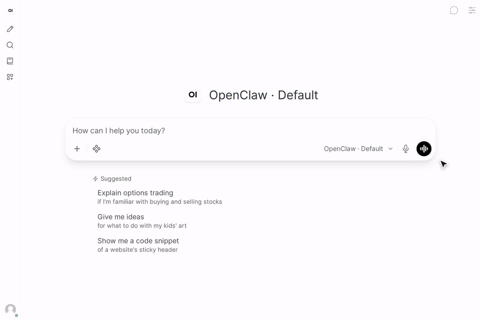

Our own setup, as one example: the agent's browser, live inside the reply that started it. The viewer behind it is a private service of ours, not part of the Pipe.

Open WebUI shows the page in a sandboxed frame, as it does every embed, so the page cannot reach Open WebUI or your login. Your service decides who may see what it shows: put it behind your own login.

Off by default. Replies you send get it; replies the agent starts itself do not.

## A link to take over from the agent

For a step only you can do, a login, a CAPTCHA or a 2FA code, the agent can hand you a page of your own service that lets you do it, then wait for you. Set [`CONTROL_LINK_PATTERN`](../configuration.md#control_link_pattern) to a pattern that matches that page's address, and when a tool result has one, the reply gets a **Take control** link right under that tool's card, while the agent waits. The link opens in a new tab. It is part of the saved message, and each link is added once per chat, however often the waiting command repeats it.

It is a link and not an embed on purpose. Open WebUI shows an embed in a sandboxed frame, and a page that takes input usually refuses to load inside one. A login page does too, so an embed would stay blank once your sign-in expired, with no way to sign in again from the chat. Opened as its own tab, the page gets its normal sign-in.

The Pipe only shows the link. Your service decides who may open the page: put it behind your own login.

Off by default.

## Thinking level

With the [thinking filter](../install/thinking-filter.md) installed, a toggle in the composer sets the reasoning level per chat: `default`, `off`, `minimal`, `low`, `medium`, `high`, `xhigh`, `max`, `ultra`.

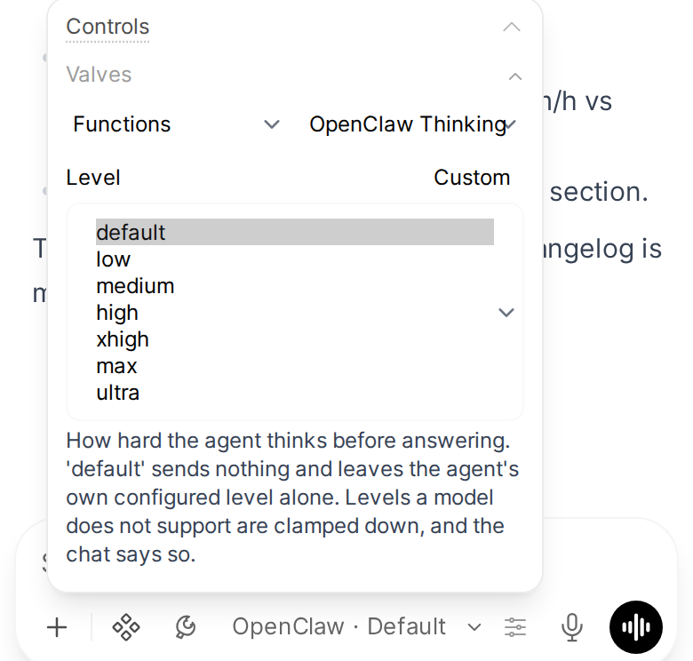

- `default` is not a level, it is the absence of one. No `thinking` field is sent, and the agent's own setting applies.
- `off` is an explicit instruction not to think, and it does override the agent's setting.

The list only offers levels a model on your Gateway supports. The Pipe reads each session's real ladder from the `sessions.describe` it already makes before every send, so this costs no extra round trip. Until the Pipe has run once, the list falls back to the five levels every observed provider supports (`off` to `high`).

Open WebUI builds the dropdown once, so it is the union across your Gateway's models, not the ladder of the model you picked. At send time the Pipe clamps the request to the nearest level the current model supports and says so once in the chat:

> _This model does not support thinking level 'ultra', using 'high' instead._

Clamping lands on the nearest level at or below what you asked for, since quietly asking for more shows up on someone's bill. The one exception: if a model has nothing at or below the request, it uses that model's lowest level, which can be higher than what you asked for.

`off` can't turn thinking off on Claude Sonnet 5.5 and Haiku 5.5 run through claude-cli. The Gateway sends it as `MAX_THINKING_TOKENS=0`, which Claude Code ignores on those models, so they still think. The Pipe treats `off` as unsupported there and sends `low`, the lowest level they honour, with the note above. Opus 5.5 and Fable never offer `off`. Other runtimes and other models keep `off`.

The filter and Open WebUI's own Advanced Params reasoning-effort control write the same `reasoning_effort` field, so they are one setting, not two that fight. The filter's [`override_advanced_params`](../configuration.md#override_advanced_params) valve (on by default) decides who wins when both are set. Install steps and the filter's valves: [thinking filter](../install/thinking-filter.md).

## Images and files from the agent

_Needs agent setup: the agent must emit `MEDIA:<path>`, see [agent skills](../install/agent-skills.md)._

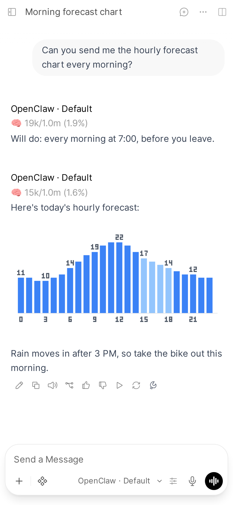

When the agent emits a `MEDIA:<filename>` line and the file exists in the Pipe's media directory (`/tmp/openclaw-pipe-media`), the Pipe:

1. Uploads it to Open WebUI's Files API (`POST /api/v1/files/?process=false`).
2. Emits a `files` event, so the file appears as a real attachment chip on the message.
3. Shows it with a same-origin link such as ``.

Because the URL is same-origin, it works over HTTPS with no mixed-content blocking. Images render inline, other file types render as a link, and a file the upload could not resolve falls back to inline code rather than a broken embed. Several `MEDIA:` lines in one reply all resolve, not just the first.

The directive is recognised even when streaming splits it mid-prefix or mid-filename, and one still buffered when the run ends is flushed, not dropped. A directive inside a code block is left alone, and writing "the MEDIA: fix" in ordinary prose does not turn the next word into a broken image link.

A `MEDIA:` line can also name a file by its path on the Gateway host, such as `MEDIA:/home/me/chart.png`, which is what an image tool's result usually gives the agent. The Pipe cannot read that path, but the Gateway can: it stores the file with the reply. This works on every model, with no shell or upload step. On the Gateway's own runtime (DeepSeek, Grok, GPT) the Gateway takes the line out of the text; on claude-cli the Pipe takes it out. Either way the Pipe shows the stored image.

Some agents make images with their own tool and never write a `MEDIA:` line: an OpenAI model on the Codex runtime is one. The Gateway stores these images, and the files named by path, after the reply ends: in the reply's stored message, or (OpenClaw 2026.10.10) in a message it adds for them. Either way it tells the Pipe, which reads them then. The Pipe waits for that notice, not for a set time. If the Gateway never stores them, the reply ends without them after 30 seconds and the Pipe logs it. This works both in a reply to your message and in a reply the agent starts on its own, such as an image tool's completion. It fetches each one from the Gateway with `GATEWAY_TOKEN` and shows it under the text the same way as a `MEDIA:` file. A reply that showed bare-name `MEDIA:` files does not show them a second time. An image the Pipe cannot fetch, or that the Gateway could not store, is named in the reply, not dropped.

The upload uses your own login from the request. `OWUI_API_KEY` is only needed if uploads fail with an auth error, or for replies the agent starts on its own (see [Replies the agent starts](./agent-turns.md#images-files-and-questions)).

If the upload is off or fails, the Pipe falls back to a small built-in HTTP file server on port 18791, which the agent can also `PUT` files to. Its `FILE_SERVER_BASE_URL` (default `http://localhost:18791`) is resolved by your **browser**, not by Open WebUI, so the default only works when you browse Open WebUI from the same host. That server is unauthenticated: read [Security](../security.md) before you rely on it. With [`ENABLE_FILE_SERVER`](../configuration.md#enable_file_server) off, there is no fallback: a file that cannot be uploaded shows in the reply as `_(a file could not be uploaded: name)_`, and a `MEDIA:` URL still shows as an image.

Valves: [`USE_OWUI_FILES`](../configuration.md#use_owui_files) (on), [`OWUI_BASE_URL`](../configuration.md#owui_base_url) (default `http://127.0.0.1:8080`, correct for a standard single-container install), [`OWUI_API_KEY`](../configuration.md#owui_api_key), [`ENABLE_FILE_SERVER`](../configuration.md#enable_file_server) (on), [`FILE_SERVER_BASE_URL`](../configuration.md#file_server_base_url).

## Images you attach

An image you attach or paste reaches the Pipe as a list of content blocks, not the plain string Open WebUI sends for text. The Pipe takes each `image_url` block, parses the `data:<mime>;base64,<data>` URI Open WebUI sends, and forwards it to the agent as a `chat.send` attachment with its MIME type and a matching file extension. A vision-capable model gets the real image bytes, not a description.

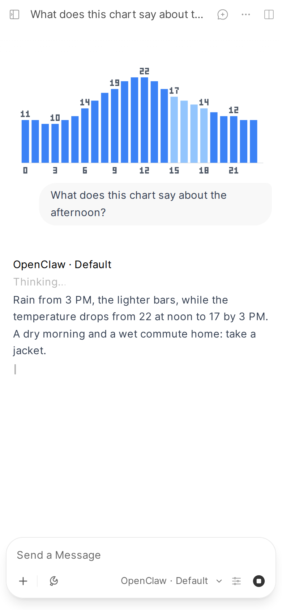

Only that inline base64 form is handled, because Open WebUI does not send plain HTTP(S) image URLs for attached or pasted images. An image the Pipe cannot forward produces a visible note that it could not be relayed, so you never get an answer confidently describing a picture the agent never received.

The Gateway refuses an image over its size cap (6 MB on OpenClaw today, read from the Gateway when it advertises it), and a phone camera photo is often bigger. The Pipe re-encodes such an image as a smaller JPEG that fits, upright as the phone shot it, and sends that; images under the cap go as they are. Re-encoding needs Pillow, which the Open WebUI image ships. Without it, or when it cannot be made to fit, the chat says so in one plain sentence instead of the Gateway's error.

Always on.

## Files and knowledge you attach

Open WebUI sends a chat's files again with every message: a document, a knowledge collection, or a chat you quoted. It retrieves text from them and puts that text before the message you typed. A model that keeps no history pays for it once per message. The agent's session keeps every message, so the same text would pile up in it, once per turn.

The Pipe therefore sends each piece of retrieved text once per session. The first message carries it in full, in Open WebUI's own format with the citation numbers the chat shows. Later messages keep the `<source>` tag of each piece the session already has, so its citation number still holds, but leave out its text and name its files in one line instead. The rest of Open WebUI's template still goes with every message. A piece the agent has not seen yet, such as a new part of a document that a new question retrieves, or a file that changed, still goes in full.

A new session starts the record afresh: `/new`, `/reset`, a deleted session, or a compaction the Gateway counts (`compactionCount`). A Gateway command such as `/status` goes as typed, with no file text before it.

Known limit: claude-cli compacts a long session on its own, and the Gateway does not count that as a compaction. After such a compaction the agent may no longer hold a file's text while the Pipe still leaves it out. Send `/new` to have it sent again.

Open WebUI 0.13.1 and later put a chat's file text into the message only for models with the **File Context** capability on. For any other chat from the browser, they offer file tools instead, and the agent can't run those tools. A Pipe model can't declare a capability itself. Without File Context, the agent never sees the files you attach.

Turn it on for every model in Open WebUI's default model settings, under Admin Panel → Settings → Models, or for one model in that model's settings. To set the default over the API, read `GET /api/v1/configs/models`, add `"DEFAULT_MODEL_METADATA": {"capabilities": {"file_context": true}}` (merged into any metadata already there), and send the whole form back with `POST /api/v1/configs/models`.

The `DEFAULT_MODEL_METADATA` environment variable only helps a new install. Open WebUI saves its model settings in its database on first start, and from then on the saved value wins over the environment (`ENABLE_PERSISTENT_CONFIG`, on by default). On an existing install, setting the variable changes nothing.

Always on.

## Voice calls

When you talk to the agent in Open WebUI's voice mode, Open WebUI marks each spoken message as part of a voice call. The Pipe puts one short note before it that tells the agent the reply will be read aloud: answer in your language, in a few short spoken sentences, with no markdown, lists, tables, code, links or emoji, and with numbers and times said the way you would say them. A message you type in the same chat carries nothing, so the agent goes back to normal answers.

The note is not shown in the chat. Turning your speech into text and reading the reply back are Open WebUI's own settings (Admin Settings, Audio), not the Pipe's.

Always on.

## System prompts

A system prompt you set in Open WebUI reaches the agent: the one on the model (Admin Settings, Models, or a workspace model built on an OpenClaw model), the one on the chat's folder (Edit folder, System prompt), and your own (the chat's Controls, else Settings, General). The Pipe joins them in Open WebUI's order, model, then folder, then yours, with Open WebUI's prompt variables such as `{{USER_NAME}}` filled in, and puts them before your message in one short note.

OpenClaw has no system prompt per message, so the note comes with every message of the chat, and a change applies from the next message on. The agent's own instructions (its workspace files, OpenClaw's system prompt) still come first and win where they disagree.

Only the prompts people set are sent. Open WebUI also writes its own instructions into the request's system prompt, for features the agent does not get (voice mode, the code interpreter, skills, knowledge, tool servers); those stay out (see [What the composer toggles do](#what-the-composer-toggles-do)). A folder prompt counts only if you may read that folder, as in Open WebUI. Channel mentions carry none: Open WebUI writes its own prompt there.

The note is not shown in the chat. No prompt set means nothing is added. A command (a message starting with `/`, such as `/model` or `/new`) goes to the Gateway as typed, without the note, since the Gateway reads commands from the message's start. When the Pipe resumes a run the Gateway lost, the resume carries the note too.

Always on.

## What the composer toggles do

Open WebUI's web search, code interpreter, tools and integrations toggles do not change what the agent sees. The agent uses the tools your OpenClaw Gateway gives it, and nothing Open WebUI adds on top.

Open WebUI offers those capabilities to a model as tools in the request. The Pipe forwards your last message as Open WebUI built it (including any file references or document passages Open WebUI added to it) the images you attach and the [system prompts](#system-prompts) people set, and nothing else from the request, so the offered tools never run and the agent never hears of them. The code interpreter's instructions to the model are dropped the same way, and so are the tools Open WebUI offers on every request, such as notes and calendar. A web search, code interpreter or tools toggle left on is harmless: the agent's prompt is the same with it on or off.

Three settings do reach the agent: the [thinking level](#thinking-level), voice mode (see [Voice calls](#voice-calls)), and the [system prompts](#system-prompts) people set.

To give the agent web search, a shell or other tools, set them up on the Gateway, not in the composer. The agent's own tool calls then show up as [tool cards](#tool-cards).

Checked against Open WebUI 0.12.5, by comparing what Open WebUI sent with what the agent's session recorded, with web search, the code interpreter and a custom tool each on.

Always on.

## Slash commands as prompts

Open WebUI's `/` menu has a fixed Commands section of its own, and a Prompts section that lists your Workspace Prompts. With [`SYNC_SLASH_COMMANDS`](../configuration.md#sync_slash_commands) on, the Pipe adds one prompt per slash command your Gateway offers (built-in commands, skills and plugin commands), so typing `/` in a chat shows them next to your own prompts, each with its description.

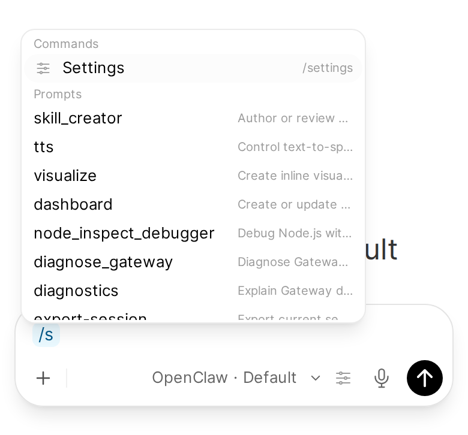

Picking one puts the command in the message box, for example `/help`; send it as it is or type more after it. A command with a required argument asks for it first, in Open WebUI's small input form (`/skill` asks for the skill's name). Optional arguments are typed after the command.

- **Who sees them:** every user. The Gateway does not say which commands are owner-only, so it still decides when one is sent: a user who is not the owner (see [Owner users](./owner-users.md)) gets the Gateway's refusal, as when typing the command by hand.
- **Your own prompts are safe:** the Pipe changes and deletes only the prompts it made. A prompt you made with the same command keeps it, and that command is skipped. The prompts it made carry the `openclaw` tag in Workspace, Prompts.
- **Left out:** the commands in [`SLASH_COMMANDS_EXCLUDE`](../configuration.md#slash_commands_exclude). The default leaves out `/status`, `/compact` and `/model`, which Open WebUI runs itself when sent alone, so they never reach OpenClaw (use the [Status dialog](./status.md#compact) to compact); `/stop`, which the Stop button does; and `/new` and `/reset`, which would reset the session under an open chat.
- **Names:** a prompt's command is the Gateway's own name. [`PROMPT_PREFIX`](../configuration.md#prompt_prefix), for example `oc_`, puts them together in the menu as `/oc_help`; the command sent is still `/help`.
- **Staying in sync:** a page load checks the Gateway, and so does the first message after [`SYNC_INTERVAL_MIN`](../configuration.md#sync_interval_min) minutes (default 30); the Gateway's own notice that its commands changed starts a check at once. A check is one small request in the background, and a message never waits for it. A command the Gateway no longer has loses its prompt.
- **Editing them in Workspace:** a change you make to a prompt the Pipe made is overwritten the next time the Gateway's commands (or these valves) change. A prompt you delete comes back only then too, not at the next check; to keep a command out of the menu, add it to `SLASH_COMMANDS_EXCLUDE`. A prompt you turn off stays off, and the Pipe keeps it up to date.
- **Turning it off** deletes the prompts the Pipe made, on the next page load or message; turning it on again adds them back at once. Each copy of the Pipe keeps its own list of the prompts it made, so turning it off in one copy leaves another copy's prompts alone.

Valves: [`SYNC_SLASH_COMMANDS`](../configuration.md#sync_slash_commands) (off), [`SLASH_COMMANDS_EXCLUDE`](../configuration.md#slash_commands_exclude) (default `stop,new,reset,model,status,compact`), [`PROMPT_PREFIX`](../configuration.md#prompt_prefix) (empty), [`SYNC_INTERVAL_MIN`](../configuration.md#sync_interval_min) (default 30).

## Usage and goal line

After every reply, a status row shows where you stand:

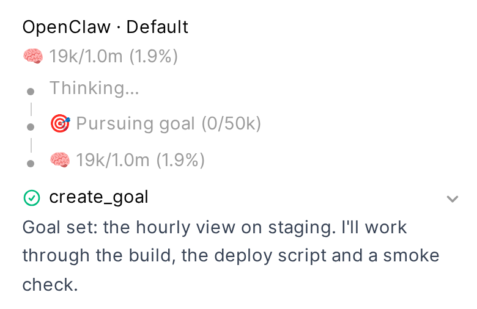

> 🧠 34k/1.0m (3.5%) · ⏱ 5h 62% left

The context number is what the reply's own run filled, read from that run's usage, so a new chat's first reply has it too.

You get one row per rate-limit window that reports a reset (`⏱ 5h 62% left (resets in 2h13m)`), and a goal line when the session has one (`🎯 Pursuing goal (204/50k)`, with paused, blocked, usage-limited, unmet and achieved variants).

The rate-limit rows come from the Gateway's `usage.status` only. On a Gateway whose only Anthropic credential is a Claude CLI login (OpenClaw 2026.9.1 and later), it reports no windows, so the rows show the context and goal without limits; the [Status dialog](./status.md#rate-limits) still shows them. The screenshot's Gateway reports no windows either.

Each fact is its own status event, because Open WebUI clamps a status row to one line and a combined string loses its numbers off the right edge.

The data comes from `sessions.describe` and `usage.status`, fetched together. It is best effort: if either call fails, the reply is unaffected. For the full picture on demand, use the [Status dialog](./status.md).

Always on.

## Context compaction

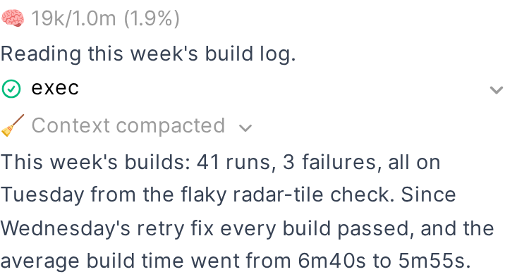

When the Gateway compacts the session in the middle of a reply (it summarizes older messages so the conversation fits the model's context window), the reply says so where it happened. While it runs, the reply shows "🧹 Compacting context…"; when it is done, that line becomes a collapsed block, "🧹 Context compacted". Open it for what compaction means: the agent continues from a summary of the older messages plus the most recent ones. Everything stays visible in the chat. A compaction that fails says so instead, and the conversation goes on uncompacted; one the Gateway skips (nothing old enough to summarize yet) or that you stop says that.

The block is part of the saved reply, so it is still there after a reload.

The Gateway reports neither the context size compacted nor the summary text, so the block shows neither.

Only a compaction the Gateway reports is marked. On OpenClaw's own agent, the one it runs to recover after the model rejected a request as too long reports nothing, so that one has no block.

Always on.

## Chat titles

The chat names itself with a short title and an emoji. When you send your second message, the Pipe titles the chat from the first exchange (your first message and the first reply). The new title shows at once in the open tab's header and sidebar, with no reload.

A title you chose stays. The Pipe replaces only the title Open WebUI gave the chat by itself ("New Chat", or your first message). If you renamed the chat, before your second message or while its title was being generated, or Open WebUI's own title model named it, the Pipe leaves it.

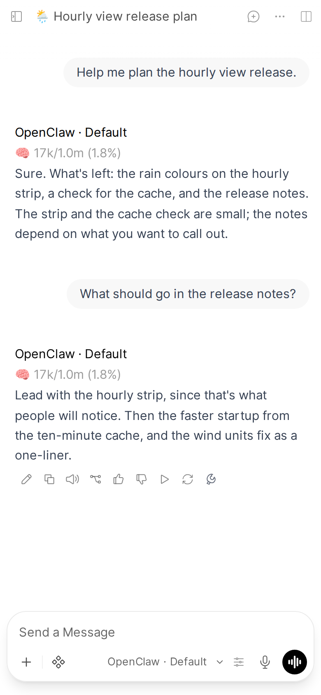

Generation runs on a separate agent, `title-gen` by default, as a background task, so it never queues behind your conversation or adds to its context, and a failure never shows. The model's output is trimmed of quotes, extra lines and anything past 80 characters before it becomes the title. If that agent does not exist on your Gateway, titles are skipped silently: define a `title-gen` agent (a fast model is enough) or point `TITLE_GEN_AGENT_ID` at one you have.

Open WebUI's own title, tag and follow-up calls never reach your agent, see [Open WebUI background tasks](./reliability.md#open-webui-background-tasks).

Valves: [`AUTO_TITLE`](../configuration.md#auto_title) (on), [`TITLE_GEN_AGENT_ID`](../configuration.md#title_gen_agent_id) (default `title-gen`).
