# Chat

What a reply looks like in the chat: live text, the agent's tool calls as real cards, failures marked, images and files both ways, a usage line under each reply, and chat titles. Everything here works as soon as the Pipe is installed, except where a section says otherwise.

Applies to: Pipe (the thinking level also needs the thinking filter)
Valves: `USE_OWUI_FILES`, `OWUI_BASE_URL`, `OWUI_API_KEY`, `ENABLE_FILE_SERVER`, `FILE_SERVER_BASE_URL`, `AUTO_TITLE`, `TITLE_GEN_AGENT_ID`, `LIVE_VIEW_URL`, `LIVE_VIEW_TOOLS`, `LIVE_VIEW_USERS`, `CONTROL_LINK_PATTERN`

## Streaming

Text appears token by token as the Gateway sends it, so a long answer starts showing at once instead of landing in one block at the end.

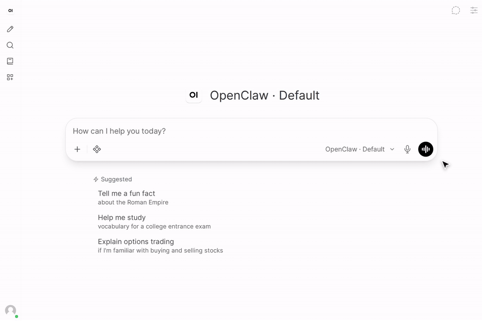

Two provider quirks are handled so you never see them:

- Some runtimes resend the whole reply as one final cumulative frame. The Pipe recognises text it has already shown and drops the repeat, so the answer is never printed twice.
- Other events carry their text as a whole item rather than as deltas. That text is shown too, not dropped.

Internal scaffolding never reaches the reply: the Sender provenance block (see [the metadata contract](../metadata-contract.md)) and the silent sentinels an agent uses to mean "say nothing" (`NO_REPLY`, `ANNOUNCE_SKIP`) are filtered out, also when the agent says one and then answers after all (a background task that reported later). A reply that ran tools and then said only a sentinel keeps its tool cards, with no text and no "no reply text" note.

Always on.

## Tool cards

Tool calls are sent as Responses-API output items, so Open WebUI draws them with its own two-phase tool card: a spinner while the tool runs, the result when it finishes. Nothing is hand-rolled HTML, so the cards match the rest of the UI and survive a reload.

Expand a card to see the arguments the agent passed and the result it got back. Arguments are capped at 3000 characters and results at 8000, so one huge tool result cannot bury the conversation.

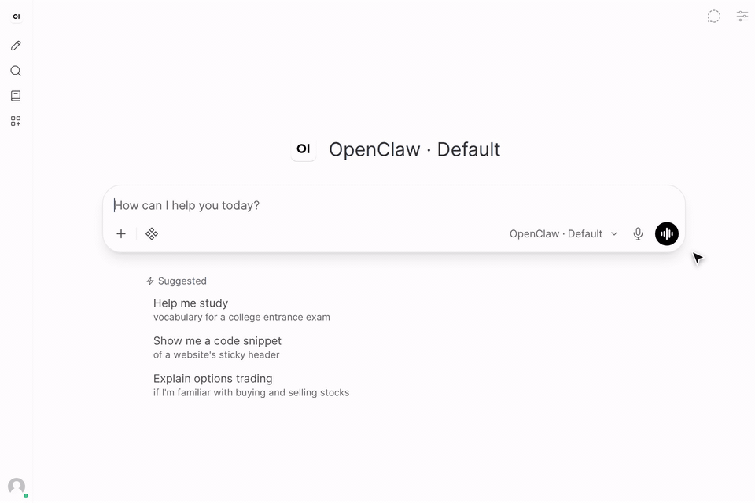

A call that arrives without a tool-call id still shows: it falls back to a Markdown `
` card rather than disappearing. The status row under the message says "Thinking..." for the whole run and does not repeat each call: the cards already show what is running, and Open WebUI saves every status change by rewriting the whole chat, so one per call made long chats slow.

Always on. On Open WebUI older than the minimum a card can keep spinning after its tool finished: see [Versions](../versions.md).

## Sub-agent cards

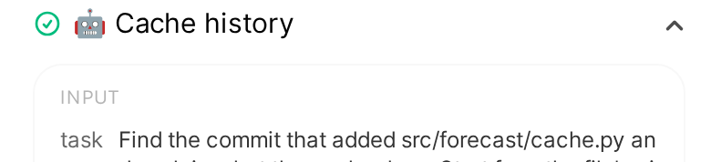

When the agent starts a sub-agent (`sessions_spawn`), its card is named after the sub-agent: 🤖 and the name the agent gave it, or the first sentence of its task, cut to 60 characters, when it gave none. Several sub-agents started in a row group as "Explored 🤖 Fly.io pricing, 🤖 Render pricing".

Expanded, the card shows the first three lines of the task, not the whole prompt, and one line of outcome: "Started: \<name\>", or "Not started" with the reason, in which case the card is marked failed like any other tool. The full task, and what the sub-agent does with it, are in its [drawer](./status.md#sub-agent-drawer).

A reply rebuilt from the transcript shows the same card.

Always on.

## Failed tools

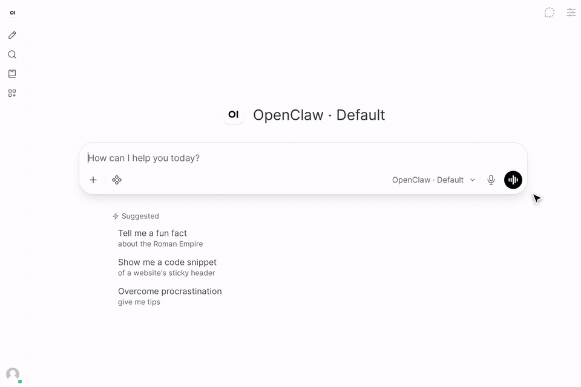

A tool call that fails gets Open WebUI's red X in place of the green check, and its card renamed to `<name> ❌`, the moment the result arrives, on any card, not only the last one. The mark is part of the saved message, so it is still there after a reload. The expanded output opens with a `❌ tool call failed` line, so the reason is visible once you open the card.

A tool that was announced but never returned, because the run was cancelled or crashed, is closed at the end of the reply with "(no result -- the run ended first)". When the run was cut by a restart and will continue, the note reads "(interrupted -- the reply continues when the run resumes)" instead. A card left spinning forever looks exactly like a hung UI, so it is never left that way.

Always on.

## Embed your own page in tool-using replies

A hook for a page you serve yourself. When a reply first makes a tool call that matches a pattern, the Pipe adds your page's address to that reply as an embed. Open WebUI shows it inside the message, under the reply, and keeps it with the message.

The Pipe ships no such page and no viewer: it only passes the address on. Without a service of your own behind that address, there is nothing to show.

- [`LIVE_VIEW_URL`](../configuration.md#live_view_url): your page's address, with `{chat_id}` and `{message_id}` where the chat's and the reply's ids go, for example `https://viewer.example.org/embed?chat={chat_id}&message={message_id}`. The two ids are all your service gets to know which reply it is showing.
- [`LIVE_VIEW_TOOLS`](../configuration.md#live_view_tools): which tool calls add it, a pattern searched in the tool's name and in the commands of its `command` argument, from the command word on. The default is a real browser launch: the `browser` tool, `openclaw browser` commands (how the agent drives its browser through exec), Chromium or Chrome started as a command, `playwright test`, `screenshot`, `open` or `codegen`, and `uv run --with playwright`. A browser word in a file the agent writes, a message, a search or a quoted string does not count. If your agent starts a browser through a script of its own, add the script to the pattern; it is matched the same way.
- [`LIVE_VIEW_USERS`](../configuration.md#live_view_users): limits it to some users.

The valves are named after the use the hook was built for, a live view of the agent's browser, but the page can be anything your service serves for a reply. See [our own setup as one example](../examples/live-browser-view.md).

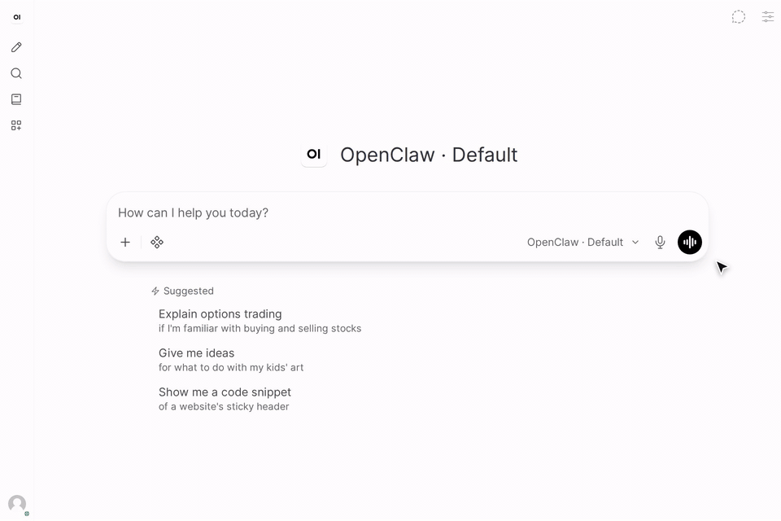

Our own setup, as one example: the agent's browser, live inside the reply that started it. The viewer behind it is a private service of ours, not part of the Pipe.

Open WebUI shows the page in a sandboxed frame, as it does every embed, so the page cannot reach Open WebUI or your login. Your service decides who may see what it shows: put it behind your own login.

Off by default. Replies you send get it; replies the agent starts itself do not.

## A link to take over from the agent

For a step only you can do, a login, a CAPTCHA or a 2FA code, the agent can hand you a page of your own service that lets you do it, then wait for you. Set [`CONTROL_LINK_PATTERN`](../configuration.md#control_link_pattern) to a pattern that matches that page's address, and when a tool result has one, the reply gets a **Take control** link right under that tool's card, while the agent waits. The link opens in a new tab. It is part of the saved message, and each link is added once per chat, however often the waiting command repeats it.

It is a link and not an embed on purpose. Open WebUI shows an embed in a sandboxed frame, and a page that takes input usually refuses to load inside one. A login page does too, so an embed would stay blank once your sign-in expired, with no way to sign in again from the chat. Opened as its own tab, the page gets its normal sign-in.

The Pipe only shows the link. Your service decides who may open the page: put it behind your own login.

Off by default.

## Thinking level

With the [thinking filter](../install/thinking-filter.md) installed, a toggle in the composer sets the reasoning level per chat: `default`, `off`, `minimal`, `low`, `medium`, `high`, `xhigh`, `max`, `ultra`.

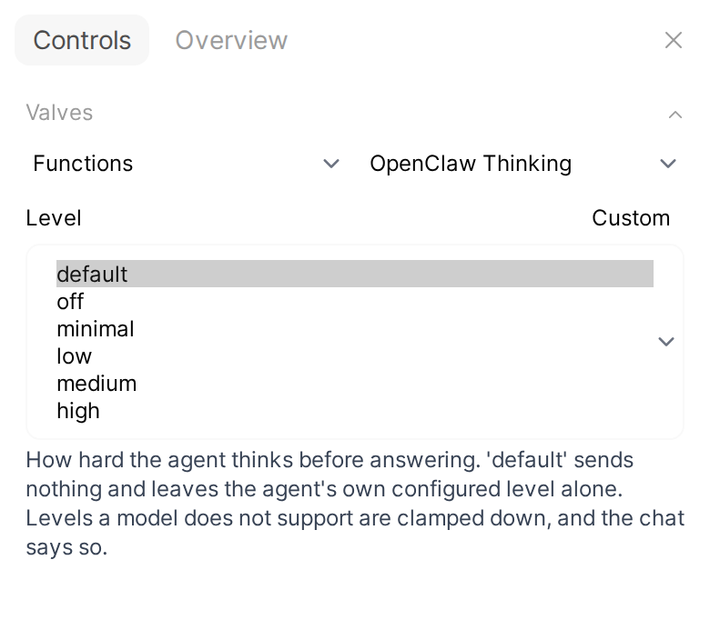 Valves, its choices listed: default, off, minimal, low, medium, high" width="320">

- `default` is not a level, it is the absence of one. No `thinking` field is sent, and the agent's own setting applies.
- `off` is an explicit instruction not to think, and it does override the agent's setting.

The list only offers levels a model on your Gateway supports. The Pipe reads each session's real ladder from the `sessions.describe` it already makes before every send, so this costs no extra round trip. Until the Pipe has run once, the list falls back to the five levels every observed provider supports (`off` to `high`).

Open WebUI builds the dropdown once, so it is the union across your Gateway's models, not the ladder of the model you picked. At send time the Pipe clamps the request to the nearest level the current model supports and says so once in the chat:

> _This model does not support thinking level 'ultra', using 'high' instead._

Clamping lands on the nearest level at or below what you asked for, since quietly asking for more shows up on someone's bill. The one exception: if a model has nothing at or below the request, it uses that model's lowest level, which can be higher than what you asked for.

The filter and Open WebUI's own Advanced Params reasoning-effort control write the same `reasoning_effort` field, so they are one setting, not two that fight. The filter's [`override_advanced_params`](../configuration.md#override_advanced_params) valve (on by default) decides who wins when both are set. Install steps and the filter's valves: [thinking filter](../install/thinking-filter.md).

## Images and files from the agent

_Needs agent setup: the agent must emit `MEDIA:<bare-filename>`, see [agent skills](../install/agent-skills.md)._

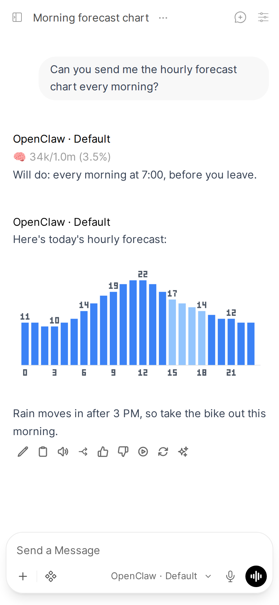

When the agent emits a `MEDIA:<filename>` line and the file exists in the Pipe's media directory (`/tmp/openclaw-pipe-media`), the Pipe:

1. Uploads it to Open WebUI's Files API (`POST /api/v1/files/?process=false`).
2. Emits a `files` event, so the file appears as a real attachment chip on the message.
3. Shows it with a same-origin link such as ``.

Because the URL is same-origin, it works over HTTPS with no mixed-content blocking. Images render inline, other file types render as a link, and a file the upload could not resolve falls back to inline code rather than a broken embed. Several `MEDIA:` lines in one reply all resolve, not just the first.

The directive is recognised even when streaming splits it mid-prefix or mid-filename, and one still buffered when the run ends is flushed, not dropped. A directive inside a code block is left alone, and writing "the MEDIA: fix" in ordinary prose does not turn the next word into a broken image link.

Some agents make images with their own tool and never write a `MEDIA:` line: an OpenAI model on the Codex runtime is one. The Gateway then attaches the images to the reply's stored message, about a second after the reply ends. In a reply to your message, the Pipe reads them from there, waiting up to 10 seconds for images the agent's tool made. It fetches each one from the Gateway with `GATEWAY_TOKEN` and shows it under the text the same way as a `MEDIA:` file. A reply that already showed `MEDIA:` files does not show them a second time. An image the Pipe cannot fetch is named in the reply, not dropped.

The upload uses your own login from the request. `OWUI_API_KEY` is only needed if uploads fail with an auth error, or for replies the agent starts on its own (see [Replies the agent starts](./agent-turns.md#images-files-and-questions)).

If the upload is off or fails, the Pipe falls back to a small built-in HTTP file server on port 18791, which the agent can also `PUT` files to. Its `FILE_SERVER_BASE_URL` (default `http://localhost:18791`) is resolved by your **browser**, not by Open WebUI, so the default only works when you browse Open WebUI from the same host. That server is unauthenticated: read [Security](../security.md) before you rely on it.

Valves: [`USE_OWUI_FILES`](../configuration.md#use_owui_files) (on), [`OWUI_BASE_URL`](../configuration.md#owui_base_url) (default `http://127.0.0.1:8080`, correct for a standard single-container install), [`OWUI_API_KEY`](../configuration.md#owui_api_key), [`ENABLE_FILE_SERVER`](../configuration.md#enable_file_server) (on), [`FILE_SERVER_BASE_URL`](../configuration.md#file_server_base_url).

## Images you attach

An image you attach or paste reaches the Pipe as a list of content blocks, not the plain string Open WebUI sends for text. The Pipe takes each `image_url` block, parses the `data:<mime>;base64,<data>` URI Open WebUI sends, and forwards it to the agent as a `chat.send` attachment with its MIME type and a matching file extension. A vision-capable model gets the real image bytes, not a description.

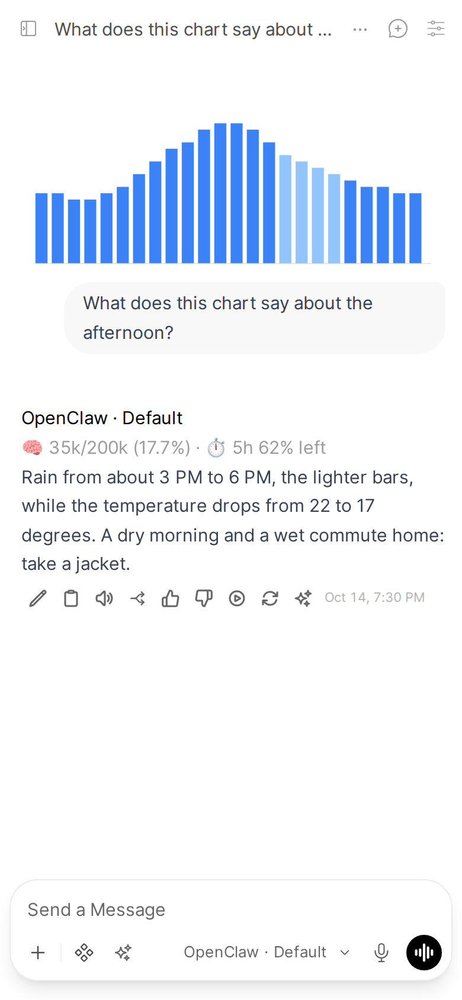

Only that inline base64 form is handled, because Open WebUI does not send plain HTTP(S) image URLs for attached or pasted images. An image the Pipe cannot forward produces a visible note that it could not be relayed, so you never get an answer confidently describing a picture the agent never received.

Always on.

## Usage and goal line

After every reply, a status row shows where you stand:

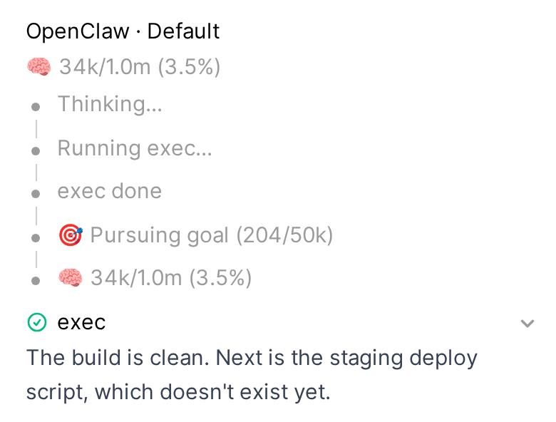

> 🧠 34k/1.0m (3.5%) · ⏱ 5h 62% left

The context number is what the reply's own run filled, read from that run's usage, so a new chat's first reply has it too.

You get one row per rate-limit window that reports a reset (`⏱ 5h 62% left (resets in 2h13m)`), and a goal line when the session has one (`🎯 Pursuing goal (204/50k)`, with paused, blocked, usage-limited, unmet and achieved variants).

The rate-limit rows come from the Gateway's `usage.status` only. On a Gateway whose only Anthropic credential is a Claude CLI login (OpenClaw 2026.9.1 and later), it reports no windows, so the rows show the context and goal without limits; the [Status dialog](./status.md#rate-limits) still shows them. The screenshot's Gateway reports no windows either.

Each fact is its own status event, because Open WebUI clamps a status row to one line and a combined string loses its numbers off the right edge.

The data comes from `sessions.describe` and `usage.status`, fetched together. It is best effort: if either call fails, the reply is unaffected. For the full picture on demand, use the [Status dialog](./status.md).

Always on.

## Context compaction

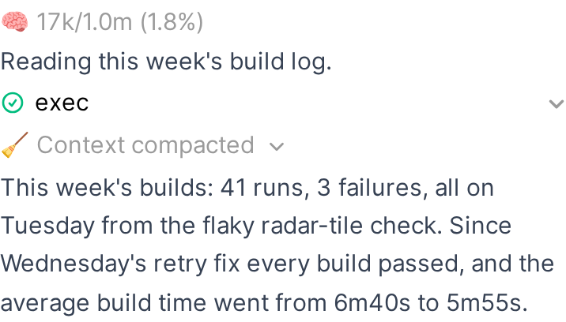

When the Gateway compacts the session in the middle of a reply (it summarizes older messages so the conversation fits the model's context window), the reply says so where it happened. While it runs, the reply shows "🧹 Compacting context…"; when it is done, that line becomes a collapsed block, "🧹 Context compacted". Open it for what compaction means: the agent continues from a summary of the older messages plus the most recent ones. Everything stays visible in the chat. A compaction that fails says so instead, and the conversation goes on uncompacted; one the Gateway skips (nothing old enough to summarize yet) or that you stop says that.

The block is part of the saved reply, so it is still there after a reload.

The Gateway reports neither the context size compacted nor the summary text, so the block shows neither.

Only a compaction the Gateway reports is marked. On OpenClaw's own agent, the one it runs to recover after the model rejected a request as too long reports nothing, so that one has no block.

Always on.

## Chat titles

The chat names itself with a short title and an emoji. When you send your second message, the Pipe titles the chat from the first exchange (your first message and the first reply). The new title shows at once in the open tab's header and sidebar, with no reload.

A title you chose stays. The Pipe replaces only the title Open WebUI gave the chat by itself ("New Chat", or your first message). If you renamed the chat, before your second message or while its title was being generated, or Open WebUI's own title model named it, the Pipe leaves it.

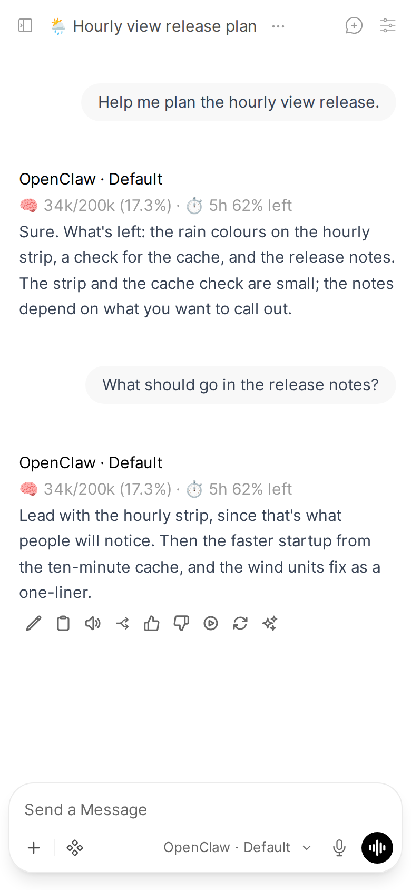

Generation runs on a separate agent, `title-gen` by default, as a background task, so it never queues behind your conversation or adds to its context, and a failure never shows. The model's output is trimmed of quotes, extra lines and anything past 80 characters before it becomes the title. If that agent does not exist on your Gateway, titles are skipped silently: define a `title-gen` agent (a fast model is enough) or point `TITLE_GEN_AGENT_ID` at one you have.

Open WebUI's own title, tag and follow-up calls never reach your agent, see [Open WebUI background tasks](./reliability.md#open-webui-background-tasks).

Valves: [`AUTO_TITLE`](../configuration.md#auto_title) (on), [`TITLE_GEN_AGENT_ID`](../configuration.md#title_gen_agent_id) (default `title-gen`).
