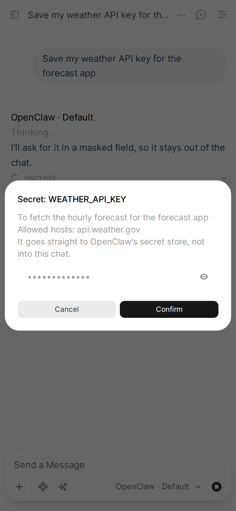

When the agent needs an answer mid-run, you get a real question card or dialog in Open WebUI instead of a wall of text nobody can answer, and a secret it requests is entered in a masked dialog that keeps it out of the chat. It survives a reload, and once answered the run continues in the same reply.

Applies to: Pipe

## How the agent asks

_Needs agent setup: the agent has to know the convention below. Install the skill or add it to your agent's instructions, see [agent skills](../install/agent-skills.md)._

The agent writes a line that starts with `OpenClaw needs input:` (or `Codex needs input:`), followed by the question. The Pipe catches it and asks you, instead of letting the raw prompt leak into the chat.

It catches the trigger however it arrives: streamed one character at a time, or in the middle of one cumulative chunk. A prompt emitted twice does not become two questions, and duplicate options are collapsed. A trigger line inside a code block is a quote, not a question.

The implementation is in [`src/openclaw_pipe_pkg/askuser.py`](../../src/openclaw_pipe_pkg/askuser.py).

## What the question looks like

The question renders as Open WebUI's own inline question card, the one its built-in `ask_user` tool uses: a header, the question, one row per option with an optional description, the first option tagged Recommended, and an Other field for a typed answer. Only a secret gets a dialog instead.

| Question looks like | Shown as |
| --- | --- |
| anything else | card with a typed answer |
| asks for a secret, password, api key or token (enter, paste, provide, ...); or mentions one with no `(y/n)` and fewer than two numbered options | dialog: a masked password field |
| `(y/n)`, or a confirm verb plus `?` | card with Yes / No |
| two or more numbered options, one per line | card, one row per option |
| `(multiselect)` or "select all that apply" | card that lists the options by number, with a typed answer |
| a JSON body with up to three `questions` | one card that steps through each |

A secret gets a dialog because the card has no masked input. The value goes only to the agent: the ❓ Ask User card in the reply shows `•••• (secret entered)` instead.

The card picks one option per question, so a multi-select question lists its options by number and you type the ones you pick: `1, 3`, `1 3`, the options' text, or both mixed. The agent gets the options, comma-separated (`Cheese, Mushrooms`). An answer that is not only option numbers and names, such as a number out of range, reaches the agent as you typed it.

An option written as `1. Postgres - needs a server` shows `Postgres` as the choice and the rest as its description.

Confirmation and multi-select markers are recognised in English, Hebrew and Arabic.

## Answering, and coming back later

Answer the card and the run continues in the same reply. The exchange stays in the reply as a collapsible ❓ Ask User card that shows both the question and your answer.

While it waits you can reload or switch away and come back:

- **Question card:** the card is shown once, on the tab that views the chat; a reload moves it to the reloaded tab. If it is not answered by Open WebUI's card timeout (4 minutes), or no tab views the chat (for example a client calling the API), the reply ends with the question as plain text.
- **Secret dialog:** the same as the card: shown once, and a reload moves it to the reloaded tab. If it is not answered within 4 minutes, or no tab views the chat, the reply says the secret was not received, without asking for it: anything typed into the chat is stored in it. The agent is told once that nothing came, so it can ask again (the dialog shows again on a tab with the chat open) or use masked credential entry.
- **Cancel on the secret dialog:** the agent is told you cancelled and nothing was entered, and the ❓ Ask User card says `Cancelled (nothing entered)`.
- **Status opened while a dialog is open:** Status opened from another tab of the chat, and the Pipe's other page updates, reach the tab with the dialog only after you answer it, so they cannot take the dialog's answer.

If you cancel any other question, or it ends as text, the question stays in the reply as ordinary text with the trigger removed (a JSON form as its numbered questions with their options), so nothing is lost. Answer it with a normal message. Sending a message while the card is open cancels it the same way, and its reply ends finished, with no "Thinking..." left on it.

## Questions from the agent's ask_user tool

OpenClaw's own `ask_user` tool works too, with no agent setup. Its questions (up to three, each with its options) show as the same question card. The option you pick, or what you type in Other, goes back to the agent as the tool's answer. A multi-select question lists its options by number, as above, and each option you name reaches the agent.

The card shows on the newest tab that has the chat open, and it waits for you:

- **No tab open** (you closed it, or your phone slept): the question stays pending. It shows as soon as you open the chat again.
- **A newer tab opens the chat** (a reload, the chat opened on your phone): the card moves there.
- **Switching the tab to another chat** does not cancel it; it shows again when you come back.
- The card has no countdown. The question ends only when you answer, press Cancel (the agent hears that you cancelled), answer it elsewhere (the Control UI; the card closes), or when the tool's own timeout ends it (15 minutes by default, set by the agent).

The Pipe knows a tab has the chat open from the Status button it adds to the composer (`COMPOSER_STATUS_BUTTON`, on by default). With that valve off, it checks for a tab every few seconds instead.

## Secrets the agent requests

_Needs OpenClaw 2026.10.10 or later. On an older Gateway the request is left to the Control UI, as before: a secret stored there cannot be used by the agent's runs yet._

When the agent asks for a credential with OpenClaw's `secrets` tool (`action: request`), the Pipe shows the same masked dialog on the chat's tab, titled with the secret's name, the agent's reason and the hosts it may be sent to.

What you type goes straight to the Gateway's secret store (`question.resolve`). It is never in the chat, Open WebUI's database, the Pipe's log, the transcript or the model's context: the agent gets only `stored` and a reference to the secret. A toast says `stored` or `cancelled`.

- **Cancel:** the agent is told the request was cancelled and nothing is stored.
- **No answer:** the dialog waits until the request expires (the agent's `timeoutSeconds`, 15 minutes by default), then the agent is told no credential arrived. It is shown like the secret dialog above: on the reply's tab, moved once to a reloaded tab.
- **Answered elsewhere** (the Control UI): the dialog's wait ends and its answer is dropped.
- **A user not in `OWNER_USERS`:** not asked. The secret store is the owner's, so a guest's chat cannot write into it; the request is left to the Control UI.

## Questions in replies the agent starts

A reply the agent starts on its own (a cron job, a sub-agent result, see [Replies the agent starts](./agent-turns.md)) can end with a question too. It is asked the same way, as a card on the tab that is viewing the chat. With no such tab open, it stays in the reply as text.
