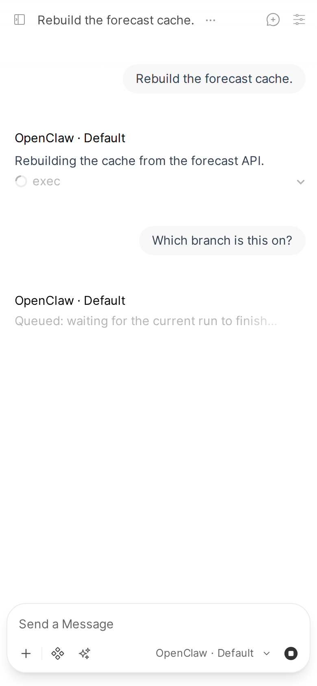
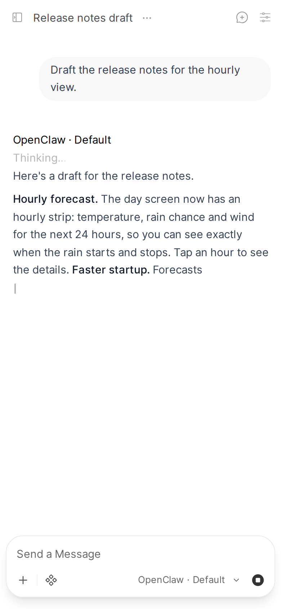
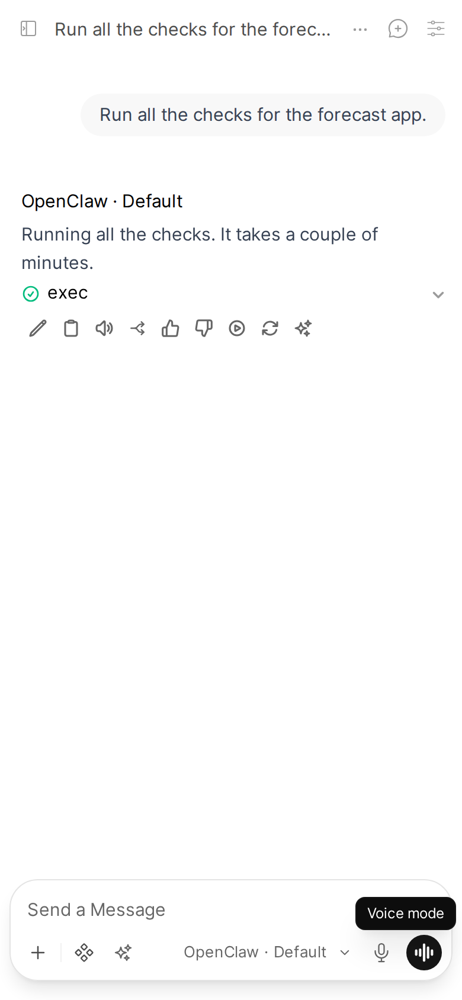
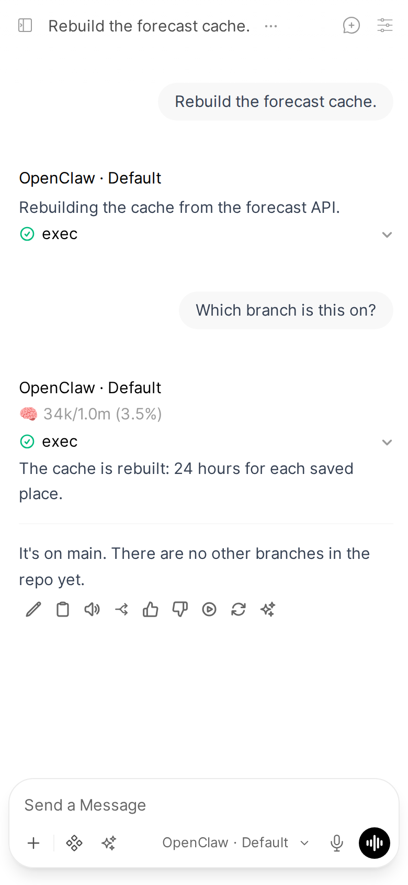

What keeps a reply whole when things go wrong: one self-healing connection, messages that queue instead of colliding, replies that survive a reload or a restart of either side, a Stop that really stops, and redeploys that leave nothing behind.

Applies to: Pipe
Valves: `GATEWAY_URL`, `GATEWAY_TOKEN`, `STATE_DIR`, `SEND_STOP_ON_CANCEL`, `INTERRUPT_GRACE_SECONDS`, `AUTO_SEND_WHILE_RUNNING`

## Persistent connection

One WebSocket connection to the Gateway is shared by every chat, rather than one per message.

It reconnects on its own with exponential backoff, from 1 second up to 30, so a Gateway restart needs nothing from you. A message sent while it waits out a backoff does not wait for the next attempt: the Pipe tries at once and sends the message on that connection. If the Gateway is still down or starting, the reply says so and you send the message again. The Gateway sends a keepalive tick (every 30 seconds by default); a socket that sends no frame for two tick intervals is treated as dead and reconnected, rather than waited on forever.

The Pipe's log while the Gateway restarts (an excerpt):

```text
[openclaw-pipe] WS disconnected -- reconnecting... (code 1006, reason '')
[openclaw-pipe]   reconnect in 1s (attempt 1)
[openclaw-pipe] Connecting to ws://localhost:18789
[openclaw-pipe]   reconnect failed: Could not connect to the OpenClaw Gateway at localhost:18789 (ConnectionRefusedError: [Errno 111] Connection refused). Is the Gateway running, and is the GATEWAY_URL valve pointing at it?
[openclaw-pipe]   reconnect in 2s (attempt 2)
[openclaw-pipe] Connecting to ws://localhost:18789
[openclaw-pipe]   reconnect failed: Could not connect to the OpenClaw Gateway at localhost:18789 (ConnectionRefusedError: [Errno 111] Connection refused). Is the Gateway running, and is the GATEWAY_URL valve pointing at it?
[openclaw-pipe]   reconnect in 4s (attempt 3)
[openclaw-pipe] Connecting to ws://localhost:18789
[openclaw-pipe]   Gateway restarted (bootId 9b526b46 -> 6dafeee8)
[openclaw-pipe] Connected to Gateway (persistent) [epoch 2]
```

Valves: [`GATEWAY_URL`](../configuration.md#gateway_url), [`GATEWAY_TOKEN`](../configuration.md#gateway_token). The full message path is in [Architecture](../architecture.md).

## Messages sent while the agent works

Send a message while the agent is working, even in the middle of a long tool call, and it is in the chat at once. The tool is not interrupted and the run is not stopped: it finishes in its own reply, with its tool card running until the tool really ends, then the agent answers your message in a reply of its own. What you do not get is a blank reply, which is what the naive implementation produces.



Left alone, Open WebUI would hold the message in a queue above the composer until the reply ends, and send it only when you click its Send now arrow. With [`AUTO_SEND_WHILE_RUNNING`](../configuration.md#auto_send_while_running) on (the default), the Pipe clicks it for you in OpenClaw chats as soon as the message is queued, and the click goes through [Send now](#send-now), which keeps the run. Turn the valve off to get Open WebUI's queue back. Open WebUI's own **Settings > Interface > Enable Message Queue** switch, when off, also sends at once, the same way.

The agent reads your message once its current run is done, not between two tool calls. On the `claude-cli` runtime the Gateway cannot add a message to a run that is already going (OpenClaw 2026.9.3: such a message is dropped), so the Pipe holds it and sends it right after the run ends.

A message from another tab or device, or one sent during a run you did not start, waits in the Pipe's own queue the same way. The status line says "Queued: waiting for the current run to finish...".

Whether a run is active comes from the Gateway: `sessions.describe`, confirmed against `sessions.list`'s `hasActiveRun`, which holds across several Open WebUI processes. A parent that is paused waiting on a sub-agent counts as busy, not finished. The wait ends when the Gateway pushes that the run settled, with no polling and no time limit. A per-session send lock means two messages released at the same moment cannot merge into one run.

Open WebUI sometimes calls the Pipe twice for the same reply. The second call does not send your message again: it follows the run the first call started and ends with that run's answer, so the agent never answers the same message twice and the real answer is never replaced.

Always on.

## Reload mid-reply

Reload the page mid-reply, or open the chat on another device, and you see the answer so far instead of an empty reply. Open WebUI keeps the in-progress reply itself and shows it on reload.



If your tab or socket dies mid-stream, the reply still finishes and is saved: Open WebUI runs and saves it on the server, not in the tab.

The device identity and token persist in `STATE_DIR`, so restarting Open WebUI or reloading the function never asks you to pair again. If `STATE_DIR` is not writable, the Pipe falls back to `/tmp/openclaw-bridge` and logs `STATE_DIR unavailable` loudly rather than failing. Details and the fix: [Device pairing](../install/pairing.md).

How Open WebUI keeps a message mid-run: [Rehydration](../rehydration-persistence.md).

Valve: [`STATE_DIR`](../configuration.md#state_dir), default `/data/openclaw-bridge`.

## Open WebUI restarts

Restarting or shutting down Open WebUI does not stop your agent. The run keeps going on the Gateway, and nothing is aborted. When Open WebUI is back, the Pipe finds the replies that were left unfinished:

- **Run still going:** the reply is picked up and streamed to the end in the same message.
- **Run ended while Open WebUI was down:** the reply is written from the run's transcript.
- **A message sent while Open WebUI was starting:** its reply is left to that message's own request, which answers it. Only a reply whose request was lost is finished by the Pipe.

## Gateway restarts

A Gateway restart in the middle of a reply does not cut it short. The reply continues in the same message, with no new message from you, and only one side continues it:

- **The Gateway recovers the run** after a crash or a planned restart, because the run is still marked running (OpenClaw 2026.10 marks it interrupted a few seconds after it starts; the Pipe keeps the message open until then). The Pipe follows the recovery run into the same message.
- **The Pipe resumes the run** when the Gateway will not: the run's process was killed from outside (it exited with code 143 or 137, or a signal, as in a container stop), or the Gateway was shut down rather than restarted.

On a resume, the agent is told what you can already see and what you asked, so it continues rather than starting over, and your original message is never sent twice. No resume is sent into a session that is busy with another run. Only the session's last run is resumed: if another run started and was killed after yours, yours ends with a cut-off note and only that later one is resumed.

Resumes are capped at 3 per reply. Past that, the reply is finished with what it has and a note: "_(This reply was cut off: the run was interrupted again after 3 attempts to continue it.)_".

## A reply that ends before its run

Sometimes the reply's request ends while the run is still going: Open WebUI closed the stream, the request was torn down, or a restart was detected. The reply is not left short, and the rest does not show up in a second message. The Pipe has been following the same run on its persistent connection all along, so it keeps streaming text and tool cards into the same message until the run ends. Then it rebuilds the message from the run's transcript (`chat.history`), so it ends exactly as an uninterrupted reply would have. Images from `MEDIA:` lines and questions still work on this path.

This needs the Open WebUI message id, which a normal chat always has. It is always on.

## Lost events

If events are lost on the way (a dropped frame, a socket gap), the reply is rebuilt from the Gateway's own transcript (`chat.history`), which holds each message whole: text and tool cards lost in the middle are put back where they belong, and a run that ended while its final event was lost is closed from its settled session row. A reply with no Open WebUI message (an API request) keeps streaming instead, and what the gap lost there stays lost.

What the Pipe logs when the Gateway socket drops mid-reply (an excerpt):

```text
[openclaw-pipe] WS disconnected -- reconnecting... (code 1006, reason '')
[openclaw-pipe]   marked an event gap in 1 run queue(s)
```

Silence is never treated as the end of a reply. A long tool call or a long stretch of silent reasoning is waited on; the reply ends only on the run's own end, its settled session row, or a restart.

There is no timer and no event count: thousands of tool calls before the first word keep the reply open too. When a run ends without text, the reason comes from its real final state, so you see **Stopped.**, the run's error, or **Failed:** the run did not complete, rather than a generic timeout. With no reason at all, the reply says "_(This turn produced no reply text.)_".

Always on.

## Stop

Pressing Stop in Open WebUI cancels the Pipe's reply. The Pipe first saves the partial answer, so what you already saw is not lost, then sends the Gateway a `chat.abort` for the run. Abort alone only ends the stream: a tool the agent started keeps running on the Gateway unless something also tells the agent to stop.



That is what `/stop` is for. With `SEND_STOP_ON_CANCEL` on (the default), the Pipe sends it right after the abort, so a long shell command or browser action is killed instead of running on against a chat nobody is watching.

The run's remaining output is never added to the stopped message later, and never posted as a message of its own.

Valve: [`SEND_STOP_ON_CANCEL`](../configuration.md#send_stop_on_cancel) (on).

## Send now

Open WebUI implements "Send now" on a queued message (and sending while a reply runs with its message queue off) as a Stop followed by the new message. Both reach the server as the same cancel, and the queue lives only in the browser, so the server cannot tell them apart. Aborting on that cancel would kill the running reply and every sub-agent it spawned.



So the Pipe asks the page. It installs a small listener in the chat page that records which you pressed: Stop or Escape, versus Send now or Enter while a reply runs. A Send now the Pipe clicks for you ([`AUTO_SEND_WHILE_RUNNING`](../configuration.md#auto_send_while_running)) is recorded as Send now too. On a cancel it reads that answer through Open WebUI's `execute` event:

- **Stop:** the run is aborted at once.
- **Send now:** the run keeps going in its own reply, to its end: a tool that was running stays running there and finishes there. Your new message is in the chat at once and waits for the run; its reply says "Queued: waiting for the current run to finish..." and then answers it.

While the page's answer is on its way, the run is held. So a Stop followed by Open WebUI auto-sending the next queued message starts that message fresh, and does not continue the run you stopped.

Nothing is dropped along the way. The run's events are buffered from the moment of the cancel, and the Pipe takes the reply over with them when your new message reaches it, so it continues exactly where it stopped. It waits for that message because Open WebUI marks the cancelled reply stopped, with its running tool cards drawn done, only as the cancel finishes, and the page sends the new message after that. If the run is killed from outside after a Send now, its reply ends with a cut-off note instead of being resumed: your new message is next, and a resume would race it. A reply interrupted before it could send its own message (Send now twice in a row, or while it waits behind a running reply) hands that message on, and the next reply sends it together with its own. The interrupted reply then says its message went with the next one, so it is never left on "Queued". A Stop instead drops a message that was still waiting, and its reply says it was not sent. Open WebUI ends a reply either by cancelling it or by closing its stream, depending on timing; both are handled the same way.

When the page cannot answer, `INTERRUPT_GRACE_SECONDS` applies as a fallback: a new message inside that window keeps the run in its own reply, as Send now does, otherwise it is aborted. That happens when Open WebUI is in a language other than English and you click Send now yourself (Stop is recognised by its icon, but a Send now click only by its English label; the Pipe's own auto-send is recorded in any language) or for a client calling the API directly. `0` aborts at once.

Valve: [`INTERRUPT_GRACE_SECONDS`](../configuration.md#interrupt_grace_seconds) (default `10`).

## Redeploys

Open WebUI's function loader runs every redeploy as a brand-new Python module, with no teardown hook for the old one. Left alone, the previous deploy's Gateway connection would live on: still receiving events, and able to write every message into your chat a second time next to the new one.

The Pipe stores its live connection on Open WebUI's own socket module, which a redeploy never reloads, instead of in a module variable that resets each time. The next deploy finds it (and any other connection an older load of the same function left running), retires it with a short timeout, and only then opens its own. Redeploys clean up after themselves with no container restart. A reply that was streaming during the redeploy is finished by the retired connection, and a message that was queued behind a running reply is still sent by it once that reply ends; the retired connection closes after both are done. Until then the new connection leaves that reply alone, so it is written once. If the reply ends before its run does, the new connection writes the rest of the run into the same message. The same pattern reaps the fallback media file server on its port, so a redeploy never leaves two processes fighting over it.

Always on.

## Open WebUI background tasks

Open WebUI quietly calls the selected model for chores: a title after the first exchange, tags, a follow-up suggestion, an emoji, autocomplete as you type, a search query for its built-in search, an image prompt, and tool selection. Each call reaches the Pipe tagged with its task name: `title_generation`, `tags_generation`, `follow_up_generation`, `emoji_generation`, `autocomplete_generation`, `query_generation`, `image_prompt_generation`, `function_calling`.

In the log:

```text
[openclaw-pipe] Skipping OWUI background task: follow_up_generation
```

The Pipe checks that tag before anything else: a match is logged and the Pipe returns at once, so none of these ever reaches your agent. Unhandled, each would be an extra run in your real session: wasted tokens, a title prompt in the agent's context, and confusing entries in its history. Open WebUI falls back on its own for an empty answer to each of these. "Merge Responses" is not skipped, since its only output is the answer itself.

This is separate from the Pipe's own [chat titles](./chat.md#chat-titles), which run on a dedicated agent instead.

Always on, not configurable.

## Continue Response

Open WebUI's Continue Response button (▷ under the last reply) asks the model to extend that reply in place. An OpenClaw run cannot be continued once it has ended, so the Pipe sends nothing to the agent and adds nothing to the reply: the reply stays as it was, and a toast says Continue isn't supported. To get more, send a message.

In the log:

```text
[openclaw-pipe] Continue Response: the reply is complete, nothing sent to the agent
```

Without this, the agent was sent its own reply as if you had written it, and its answer was glued onto the end of the reply.

## Errors and logs

Errors name the valve, the config key or the command that fixes them, and every reply logs to the Open WebUI backend log with an `[openclaw-pipe]` prefix. Both are covered in [Troubleshooting](../troubleshooting.md).
