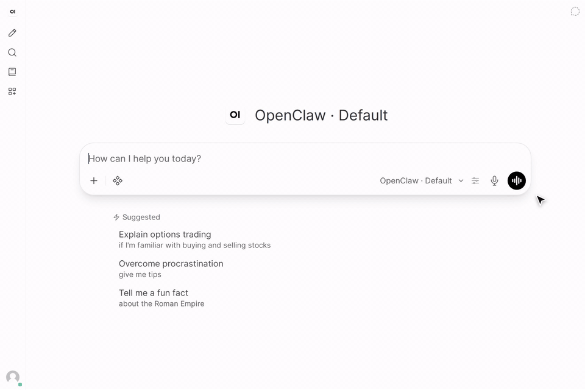
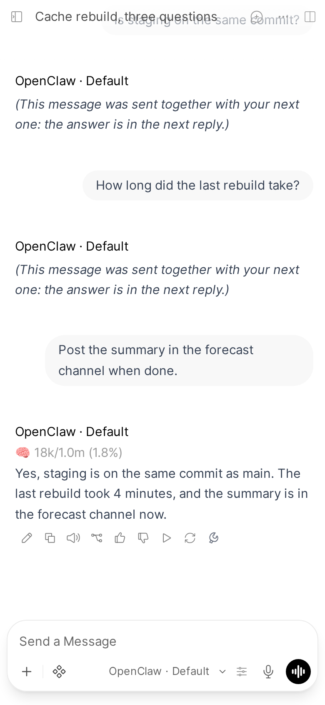
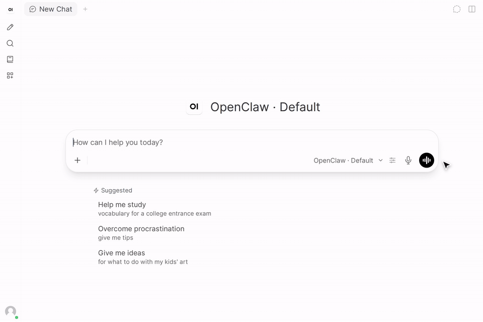
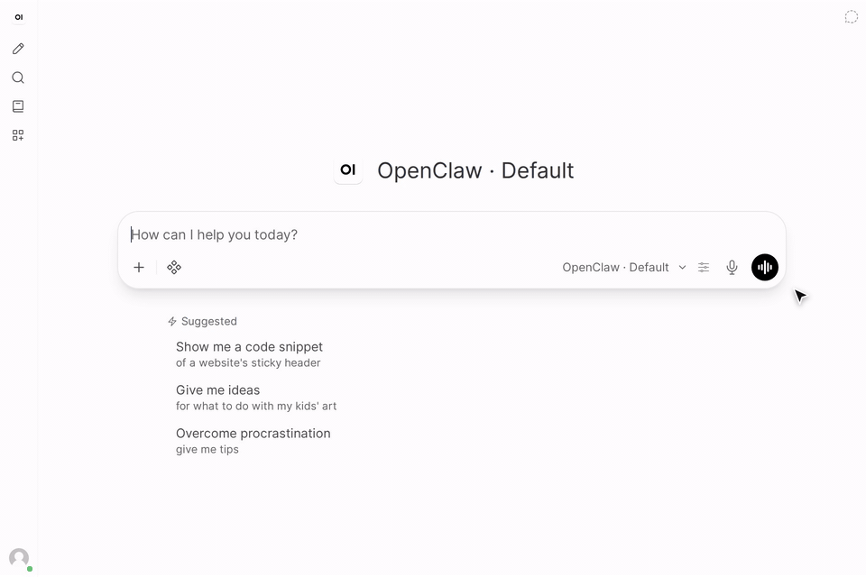
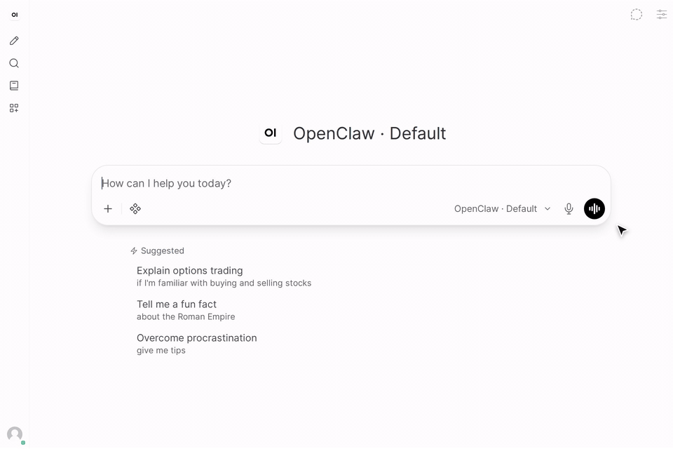

# Reliability

What keeps a reply whole when things go wrong: one self-healing connection, messages that queue instead of colliding, replies that survive a reload or a restart of either side, a Stop that really stops, and redeploys that leave nothing behind.

Applies to: Pipe
Valves: `GATEWAY_URL`, `GATEWAY_TOKEN`, `STATE_DIR`, `SEND_STOP_ON_CANCEL`, `INTERRUPT_GRACE_SECONDS`, `AUTO_SEND_WHILE_RUNNING`

## Persistent connection

One WebSocket connection to the Gateway is shared by every chat, rather than one per message.

It reconnects on its own with exponential backoff, from 1 second up to 30, so a Gateway restart needs nothing from you. A message sent while it waits out a backoff does not wait for the next attempt: the Pipe tries at once and sends the message on that connection. If the Gateway is still down (it refuses the connection, as during a restart), the message waits for it, trying again every second, up to 2 minutes, and then gets its reply; past that, the message is [kept in the chat](#messages-kept-while-the-gateway-is-down) until the Gateway is back. A Gateway that is up but still starting (OpenClaw 2026.10.5 and later refuse connections until their startup sidecars run, then runs until the agent's database is inspected and prepared, for some seconds after a restart) is waited for: the Pipe connects and sends again after the wait each refusal names, up to 5 minutes, and the message gets its reply. Any other refusal the Gateway marks as retryable is sent again too, for up to 30 seconds, and so are two refusals OpenClaw 2026.11.5 and later give in the first moments after a restart without marking them retryable, though they say to retry: a request whose session changed under it, and one refused because the session's access facts are not readable yet. A message sent while the Gateway restarts is retried instead of failing. OpenClaw 2026.10.5 can also take a message right after a restart and then drop it, when another write lands on its database at that moment (`Pending input authority changed before publication`); its key is spent then, so the Pipe sends the message once more under a new key and it gets its reply. A second such refusal shows the error. A message already queued behind a running reply when the socket drops keeps waiting: while the Pipe cannot ask the Gateway whether that run is still going, it treats it as still going, and sends the message once it has reconnected and the run has finished. The Gateway sends a keepalive tick (every 30 seconds by default); a socket that sends no frame for two tick intervals is treated as dead and reconnected, rather than waited on forever.

The Pipe's log while the Gateway restarts (an excerpt):

```text
[openclaw-pipe] WS disconnected -- reconnecting... (sent none, received 1012 'service restart')
[openclaw-pipe]   reconnect in 1s (attempt 1)
[openclaw-pipe] Connecting to ws://localhost:18789
[openclaw-pipe]   reconnect failed: Could not connect to the OpenClaw Gateway at localhost:18789 (ConnectionRefusedError: [Errno 111] Connection refused). Is the Gateway running, and is the GATEWAY_URL valve pointing at it?
[openclaw-pipe]   reconnect in 2s (attempt 2)
[openclaw-pipe] Connecting to ws://localhost:18789
[openclaw-pipe]   reconnect failed: Could not connect to the OpenClaw Gateway at localhost:18789 (ConnectionRefusedError: [Errno 111] Connection refused). Is the Gateway running, and is the GATEWAY_URL valve pointing at it?
[openclaw-pipe]   reconnect in 4s (attempt 3)
[openclaw-pipe] Connecting to ws://localhost:18789
[openclaw-pipe]   Gateway restarted (bootId 9b526b46 -> 6dafeee8)
[openclaw-pipe] Connected to Gateway (persistent) [epoch 2]
```

Valves: [`GATEWAY_URL`](../configuration.md#gateway_url), [`GATEWAY_TOKEN`](../configuration.md#gateway_token). The full message path is in [Architecture](../architecture.md).

## Messages kept while the Gateway is down

A message sent while the Gateway is down is not lost, and you do not have to notice and send it again. After the 2 minutes the Pipe waits for a reconnect (see [Persistent connection](#persistent-connection)), the message is kept in the chat: its reply shows "Waiting for the gateway…" (in Hebrew, "אין חיבור כרגע, ממתין…", when Open WebUI is set to Hebrew; see [Status lines in your language](./chat.md#status-lines-in-your-language)) instead of an error. Once the Gateway is back, the message goes to the agent as you sent it, and the answer, tool cards included, streams into that same reply. The reply starts with the time you sent it (the message's own time in Open WebUI, or the `sent_at` a client sends in the request metadata, in seconds or milliseconds), and the agent is told the message is late and when you wrote it, so "do it now" is read at the time you meant.

Messages you send meanwhile in the same chat go behind it, at once, and reach the agent in the order you sent them, each once: a message is sent when the run of the one before it has ended, so each gets its own reply. A message that cannot wait, because waiting would not help (a wrong token, a refused device), still shows its error. A message that went together with others as one send, a channel mention and an Open WebUI background task are not kept.

Nothing of the Pipe's own holds the message: it stays in the chat, whose reply carries `meta.delivery` (`pending`, `sending`, `delivered`) and what the Pipe needs to send it again, and the chat's `meta.openclaw_pending` lists the waiting message ids in order. One background task per Open WebUI process (started once however often the Function is reloaded or updated) sends the first of each chat's list when the Gateway answers, trying again with a growing pause while it does not. The state is in Open WebUI's database, so a restart of Open WebUI or a redeploy while a message waits loses nothing: the first model listing after the start finds it. A message is claimed before it is sent, so two processes cannot send it twice: a claim is taken over only when its process is gone (looked up as the turn writers' are, on this host) or after 5 minutes (another host's process cannot be looked up). A send that reached the Gateway but was not recorded is sent again under its first idempotency key, which the Gateway answers with the run it already has. If Open WebUI stops between keeping a message and arming its reply, the first start after it arms the message again.

Stop does not take a waiting reply back in this version: Open WebUI keeps the stored copy of a message that is not done, so the page's Stop does not reach it. Delete the message to cancel it.

A waiting reply is not an orphan: the [orphaned reply sweep](#open-webui-restarts) leaves it to that task.

## Messages sent while the agent works

Send a message while the agent is working, even in the middle of a long tool call, and it is in the chat at once. The tool is not interrupted and the run is not stopped. What you do not get is a blank reply, which is what the naive implementation produces. On OpenClaw 2026.10.10 and later a text message is steered into the run (below). On older Gateways, and for a message with images or files, the run finishes in its own reply, with its tool card running until the tool really ends, then the agent answers your message in a reply of its own.



Left alone, Open WebUI would hold the message in a queue above the composer until the reply ends, and send it only when you click its Send now arrow. With [`AUTO_SEND_WHILE_RUNNING`](../configuration.md#auto_send_while_running) on (the default), the Pipe clicks it for you in OpenClaw chats as soon as the message is queued, and the click goes through [Send now](#send-now), which keeps the run. Turn the valve off to get Open WebUI's queue back. Open WebUI's own **Settings > Interface > Enable Message Queue** switch, when off, also sends at once, the same way.

From Open WebUI 0.13.4 a message you send in your own saved chat goes to the server at once, while the reply still runs: no Send now ends that reply first, as it did up to 0.13.3. The Pipe does it instead. It ends the running reply's request the way Open WebUI's Stop does, counts that as a Send now, and the run goes on in its own message exactly as after a Send now, while your message is steered in or waits behind it. A Stop you press afterwards is still a Stop. Only your own replies in that chat are ended this way, as Open WebUI's Stop ends only your own; another user's message in a shared chat never ends yours, and a channel thread is never touched. The server would otherwise hold the message under the running reply until it ends; the Pipe keeps it from holding a message for an OpenClaw reply. In those chats the item that shows in the queue for a moment is Open WebUI's guess while the send is on its way, and its Send now stops the reply, so the Pipe does not click it. In a temporary chat Open WebUI still queues in the browser, and the Pipe clicks Send now there as before.

This uses an Open WebUI internal, `open_webui.tasks.stop_task`. `install.py status` reports `send_while_running_handover` for the Open WebUI it finds (tested on 0.13.4); if a newer release changed that function, the Pipe logs `stop_task is missing` and a message sent while a reply runs is steered in without ending the reply. When Open WebUI runs several server processes (`UVICORN_WORKERS` above 1), the Pipe can end only a reply whose request runs in the same process as your message; it logs one line at load, and one each time a reply is out of its reach.

A text message goes to the agent at once and the Gateway steers it into the running run: the agent reads it at its next step (after the tool call it is in, or at the end of what it is writing) and answers it then, in the same run. Its reply says "Sent while the agent works: it reads it at its next step..." until then. The reply that was running ends where your message went in, and the rest of the run, the answer, shows under your message. Nothing waits for the whole run to finish, so "stop and do X instead" works mid-run.

The boundary is the Gateway's own event: your message is written to the transcript (`session.message`, keyed by its send) right before the agent's next step, and every event of the run after it goes to your message's reply. A message whose send reaches the Gateway only after that step is steered in at the step after it. Several messages that reach the same step go in together: the last one's reply has the answer, and the earlier ones say their message was sent together with the next. A reload, or a lost connection to the Gateway, rebuilds both replies from the transcript, split at your message the same way. The transcript stores your message when you send it, so what the agent wrote between your send and its next step sorts after it; the Pipe reads your message where the agent took it in (its commit time), so that text stays in the running reply. The same holds when a later message's Send now cancelled your message's reply before the agent took it in: the running reply still ends there, and your reply shows its answer from the transcript once the run ends.

On the `claude-cli` runtime the Gateway writes your message to the transcript once Claude Code takes it in, but it can forward Claude Code's first words of the answer before that. Those words then show at the end of the running reply for a moment. Once the run ends, the Pipe reads the transcript and moves them to your message's reply. It only moves the split: if either reply holds anything the transcript does not, both stay as they are.

Only a run that one of your messages in this chat started is steered into. A run the agent started by itself (a scheduled wake, a sub-agent's result) is not: the Gateway would not steer into it and would hold the message in its own queue instead, where 2026.10.10-beta.1 drops it. A message sent during such a run waits for it, as below.

A message with images or files still waits: the Gateway would only queue it behind the run.

A held message from another tab or device, or one sent during a run you did not start, waits in the Pipe's own queue the same way. The status line says "Queued: waiting for the current run to finish..." until the message's own run starts, then "Thinking..." as for any running reply. OpenClaw 2026.11.5 reports every message "queued" while it admits it; the reply says "Waiting" only while another run of the chat is going, and that line too gives way once the message's run starts.

Several messages that wait behind the same run (messages with images, or held as above) go out together, as one turn, when it ends: the agent reads them in the order you sent them, a blank line apart, with every image attached to any of them. The answer appears under the last one, and the replies of the earlier ones say their message was sent together with the next. A message you send once that turn has started waits for it and is answered on its own. A command (`/model`, `/new`, ...) never joins: it goes on its own, in its place, so messages sent before it go out before it and messages sent after it after it. The same holds for a message handed on by [Send now](#send-now). One message sent while the agent works, then another while it answers the first, are two turns: the first had already gone out.



Whether a run is active comes from the Gateway: `sessions.describe`, confirmed against `sessions.list`'s `hasActiveRun`, which holds across several Open WebUI processes. A parent that is paused waiting on a sub-agent counts as busy, not finished. The wait ends when the Gateway pushes that the run settled, with no polling and no time limit. The Pipe reads the session again on every change the Gateway pushes for it, not only on one that says a run is active, because OpenClaw 2026.10.10 announces the end of a cron wake's run in a change that says nothing about runs: a message sent while a wake streamed goes out when the wake ends, not at the next Gateway restart. A per-session send lock keeps two sends from reaching the Gateway at the same moment, where it would fold the second into the first run and its reply would show nothing.

Open WebUI sometimes calls the Pipe twice for the same reply. The second call does not send your message again: it follows the run the first call started and ends with that run's answer, so the agent never answers the same message twice and the real answer is never replaced.

Always on.

## Reload mid-reply

Reload the page mid-reply, or open the chat on another device, and you see the answer so far instead of an empty reply. Open WebUI keeps the in-progress reply itself and shows it on reload.



If your tab or socket dies mid-stream, the reply still finishes and is saved: Open WebUI runs and saves it on the server, not in the tab.

The device identity and token persist in `STATE_DIR`, so restarting Open WebUI or reloading the function never asks you to pair again. If `STATE_DIR` is not writable, the Pipe falls back to `/tmp/openclaw-bridge` and logs `STATE_DIR unavailable` loudly rather than failing. Details and the fix: [Device pairing](../install/pairing.md).

How Open WebUI keeps a message mid-run: [Rehydration](../rehydration-persistence.md).

Valve: [`STATE_DIR`](../configuration.md#state_dir), default `/data/openclaw-bridge`.

## Open WebUI restarts

Restarting or shutting down Open WebUI does not stop your agent. The run keeps going on the Gateway, and nothing is aborted. When Open WebUI is back, the Pipe finds the replies that were left unfinished:

- **Run still going:** the reply is picked up and streamed to the end in the same message.
- **Run ended while Open WebUI was down:** the reply is written from the run's transcript. A reply you stopped stays as it was: what you stopped is what it shows. Only a run that ended after Open WebUI's last finished reply counts as ended while it was down; a scheduled result written then keeps the time it was committed.
- **A message sent while Open WebUI was starting:** its reply is left to that message's own request, which answers it. Only a reply whose request was lost is finished by the Pipe.

## Gateway restarts

A Gateway restart in the middle of a reply does not cut it short. The reply continues in the same message, with no new message from you, and only one side continues it:

- **The Gateway recovers the run** after a crash or a planned restart, because the run is still marked running (OpenClaw 2026.10 marks it interrupted a few seconds after it starts; the Pipe keeps the message open until then). The Pipe follows the recovery run into the same message.
- **The Pipe resumes the run** when the Gateway will not: the run's process was killed from outside (it exited with code 143 or 137, or a signal, as in a container stop), or the Gateway was shut down rather than restarted.

On a resume, the agent is told what you can already see and what you asked, so it continues rather than starting over, and your original message is never sent twice. No resume is sent into a session that is busy with another run. Only the session's last run is resumed: if another run started and was killed after yours, yours ends with a cut-off note and only that later one is resumed.

Resumes are capped at 3 per reply. Past that, the reply is finished with what it has and a note: "_(This reply was cut off: the run was interrupted again after 3 attempts to continue it.)_".

## A reply that ends before its run

Sometimes the reply's request ends while the run is still going: Open WebUI closed the stream, the request was torn down, or a restart was detected. The reply is not left short, and the rest does not show up in a second message. The Pipe has been following the same run on its persistent connection all along, so it keeps streaming text and tool cards into the same message until the run ends. Then it rebuilds the message from the run's transcript (`chat.history`), so it ends exactly as an uninterrupted reply would have. Images from `MEDIA:` lines and questions still work on this path.

This needs the Open WebUI message id, which a normal chat always has. It is always on.

## Lost events

If events are lost on the way (a dropped frame, a socket gap), the reply is rebuilt from the Gateway's own transcript (`chat.history`), which holds each message whole: text and tool cards lost in the middle are put back where they belong, and a run that ended while its final event was lost is closed from its settled session row. A reply with no Open WebUI message (an API request) keeps streaming instead, and what the gap lost there stays lost.

What the Pipe logs when the Gateway socket drops mid-reply (an excerpt):

```text
[openclaw-pipe] WS disconnected -- reconnecting... (sent none, received none)
[openclaw-pipe]   marked an event gap in 1 run queue(s)
```

Silence is never treated as the end of a reply. A long tool call or a long stretch of silent reasoning is waited on; the reply ends only on the run's own end, its settled session row, or a restart.

There is no timer and no event count: thousands of tool calls before the first word keep the reply open too. When a run ends without text, the reason comes from its real final state, so you see **Stopped.** (also for a stop from another surface, such as the Control UI or Telegram), **The response timed out.** Please try again. (also when the Gateway stops a run at its deadline), **The response failed.** Please try again., or the run's error, rather than a generic timeout. A reply whose run ended with no final event reached says **The reply didn't finish.** when its row has no error. A reply you stop in Open WebUI after it showed text keeps its "Stopped" status line; one stopped before any text says **Stopped.** in its text instead ([Stop](#stop)). A message you send while the agent works is no Stop, though Open WebUI ends the running reply's request for it the same way: when the message reaches the Pipe while the run is held for it ([Send now](#send-now)), that reply keeps what it showed, with no "Stopped", and the run goes on with your message. With no hold (`INTERRUPT_GRACE_SECONDS` at 0), or when the page cannot say which button it was and the message comes after the fallback window, the run was stopped, and the reply says so. A run that ended because it waits for its sub-agents (`sessions_yield`) says so instead, and their answer follows as the next reply ([Sub-agent results](./agent-turns.md#sub-agent-results)). With no reason at all, the reply says "_(This turn produced no reply text.)_".

Always on.

## Stop

Pressing Stop in Open WebUI cancels the Pipe's reply. The Pipe first saves the partial answer, so what you already saw is not lost, then sends the Gateway a `chat.abort` for the run. Abort alone only ends the stream: a tool the agent started keeps running on the Gateway unless something also tells the agent to stop.



That is what `/stop` is for. With `SEND_STOP_ON_CANCEL` on (the default), the Pipe sends it right after the abort, so a long shell command or browser action is killed instead of running on against a chat nobody is watching.

The run's remaining output is never added to the stopped message later, and never posted as a message of its own. A reply stopped before it said anything is saved as "**Stopped.**" (in your [interface language](./chat.md#status-lines-in-your-language)) after its tool cards, so a reload and the chat show what happened instead of an empty bubble. That text says it, so its "Stopped" status line goes, and the reply says it once. A stopped reply's tool cards read as a finished reply's, with the same headers in your language: Open WebUI marks a card that was still open when you stopped `incomplete` and shows such a card, or a group with one, by the tool's name, so after its save the Pipe closes them, a call that never got its result saying "Stopped".

Valve: [`SEND_STOP_ON_CANCEL`](../configuration.md#send_stop_on_cancel) (on).

## Send now

Open WebUI implements "Send now" on a queued message (and sending while a reply runs with its message queue off) as a Stop followed by the new message. Both reach the server as the same cancel, and the queue lives only in the browser, so the server cannot tell them apart. Aborting on that cancel would kill the running reply and every sub-agent it spawned.



So the Pipe asks the page. It installs a small listener in the chat page that records which you pressed: Stop or Escape, versus Send now or Enter while a reply runs. A Send now the Pipe clicks for you ([`AUTO_SEND_WHILE_RUNNING`](../configuration.md#auto_send_while_running)) is recorded as Send now too. On a cancel it reads that answer through Open WebUI's `execute` event:

- **Stop:** the run is aborted at once.
- **Send now:** the run keeps going in its own reply: a tool that was running stays running there and finishes there. Your new message is in the chat at once. On OpenClaw 2026.10.10 and later it is [steered into the run](#messages-sent-while-the-agent-works): the run's reply ends at the agent's next step, and your message's reply shows the answer. On older Gateways it waits for the run; its reply says "Queued: waiting for the current run to finish..." and then answers it.

While the page's answer is on its way, the run is held. So a Stop followed by Open WebUI auto-sending the next queued message starts that message fresh, and does not continue the run you stopped.

Nothing is dropped along the way. The run's events are buffered from the moment of the cancel, and the Pipe takes the reply over with them when your new message reaches it, so it continues exactly where it stopped. It waits for that message because Open WebUI marks the cancelled reply stopped, with its running tool cards drawn done, only as the cancel finishes, and the page sends the new message after that. If the run is killed from outside after a Send now, its reply ends with a cut-off note instead of being resumed: your new message is next, and a resume would race it. A reply interrupted before it could send its own message (Send now twice in a row, or while it waits behind a running reply) hands that message on, with its images, and the next reply sends it together with its own. The interrupted reply then says its message went with the next one, so it is never left on "Queued". A Stop instead drops a message that was still waiting, and its reply says it was not sent. Open WebUI ends a reply either by cancelling it or by closing its stream, depending on timing; both are handled the same way.

When the page cannot answer, `INTERRUPT_GRACE_SECONDS` applies as a fallback: a new message inside that window keeps the run in its own reply, as Send now does, otherwise it is aborted. That happens when Open WebUI is in a language other than English and you click Send now yourself (Stop is recognised by its icon, but a Send now click only by its English label; the Pipe's own auto-send is recorded in any language) or for a client calling the API directly. `0` aborts at once.

Valve: [`INTERRUPT_GRACE_SECONDS`](../configuration.md#interrupt_grace_seconds) (default `10`).

## Redeploys

Open WebUI's function loader runs every redeploy as a brand-new Python module, with no teardown hook for the old one. Left alone, the previous deploy's Gateway connection would live on: still receiving events, and able to write every message into your chat a second time next to the new one.

The Pipe stores its live connection on Open WebUI's own socket module, which a redeploy never reloads, instead of in a module variable that resets each time. The next deploy finds it (and any other connection an older load of the same function left running), retires it with a short timeout, and only then opens its own. Redeploys clean up after themselves with no container restart. A reply that was streaming during the redeploy is finished by the retired connection, and a message that was queued behind a running reply is still sent by it once that reply ends; the retired connection closes after both are done. A retired connection from a build older than the device names would reconnect without a name if its socket dropped, which wipes the name the Gateway stored for the shared device, so the next deploy pins such a connection shut: it keeps reading its open socket until its runs are done, then closes it with a normal close frame. It takes no new work and never connects again. If the socket drops first, the replies still reading it end with what they showed and the new connection writes the rest of their runs into the same message. Until then the new connection leaves that reply alone, so it is written once. If the reply ends before its run does, the new connection writes the rest of the run into the same message. The same pattern reaps the fallback media file server on its port, so a redeploy never leaves two processes fighting over it.

Always on.

## Open WebUI background tasks

Open WebUI quietly calls the selected model for chores: a title after the first exchange, tags, a follow-up suggestion, an emoji, autocomplete as you type, a search query for its built-in search, an image prompt, and tool selection. Each call reaches the Pipe tagged with its task name: `title_generation`, `tags_generation`, `follow_up_generation`, `emoji_generation`, `autocomplete_generation`, `query_generation`, `image_prompt_generation`, `function_calling`.

In the log:

```text
[openclaw-pipe] Skipping OWUI background task: follow_up_generation
```

The Pipe checks that tag before anything else: a match is logged and the Pipe returns at once, so none of these ever reaches your agent. Unhandled, each would be an extra run in your real session: wasted tokens, a title prompt in the agent's context, and confusing entries in its history. Open WebUI falls back on its own for an empty answer to each of these. "Merge Responses" is not skipped, since its only output is the answer itself.

This is separate from the Pipe's own [chat titles](./chat.md#chat-titles), which run on a dedicated agent instead.

Always on, not configurable.

## Continue Response

Open WebUI's Continue Response button (▷ under the last reply) asks the model to extend that reply in place. An OpenClaw run cannot be continued once it has ended, so the Pipe sends nothing to the agent and adds nothing to the reply: the reply stays as it was, and a toast says Continue isn't supported. To get more, send a message.

In the log:

```text
[openclaw-pipe] Continue Response: the reply is complete, nothing sent to the agent
```

Without this, the agent was sent its own reply as if you had written it, and its answer was glued onto the end of the reply.

## Errors and logs

Errors name the valve, the config key or the command that fixes them, and every reply logs to the Open WebUI backend log with an `[openclaw-pipe]` prefix. Both are covered in [Troubleshooting](../troubleshooting.md).
