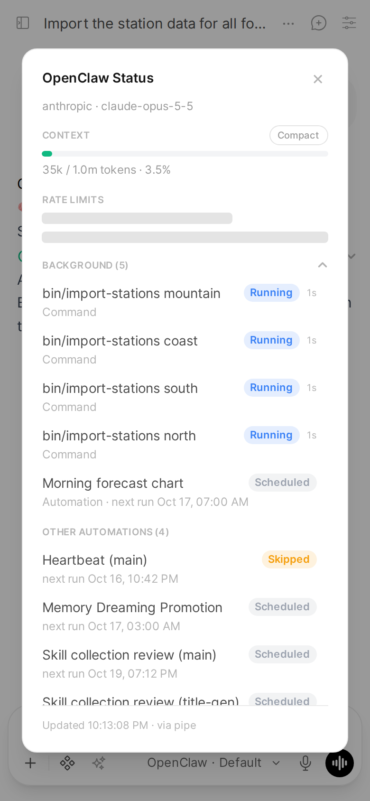
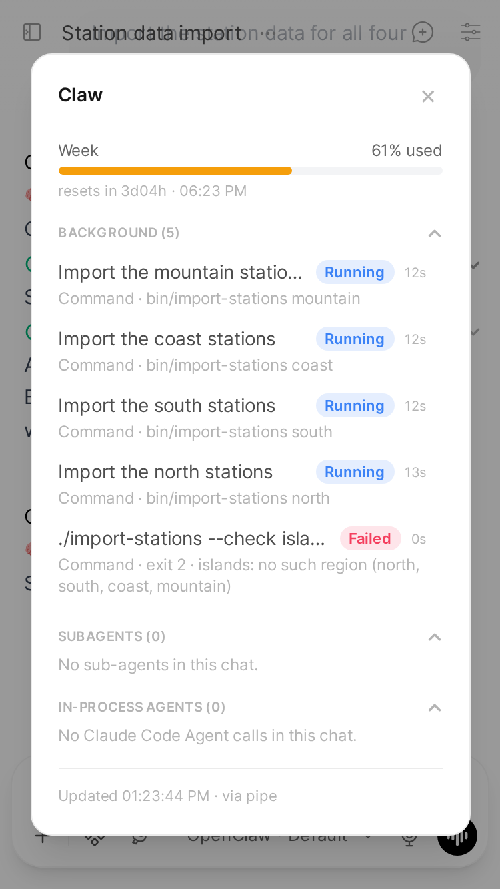
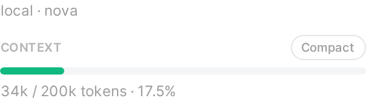
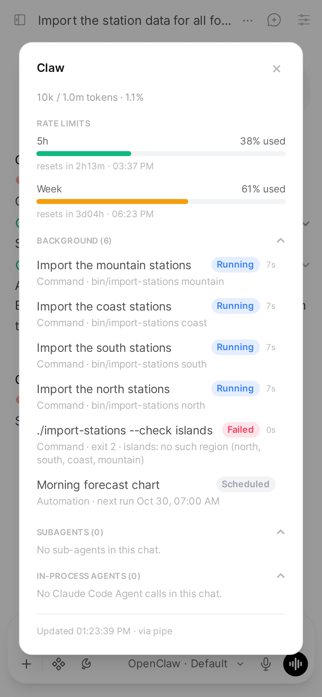
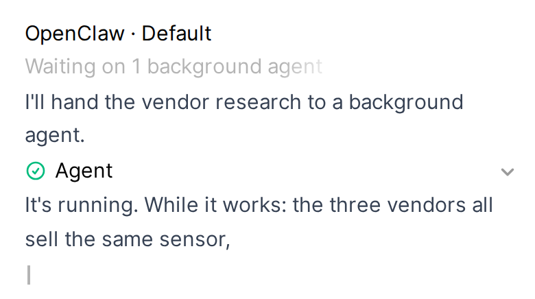
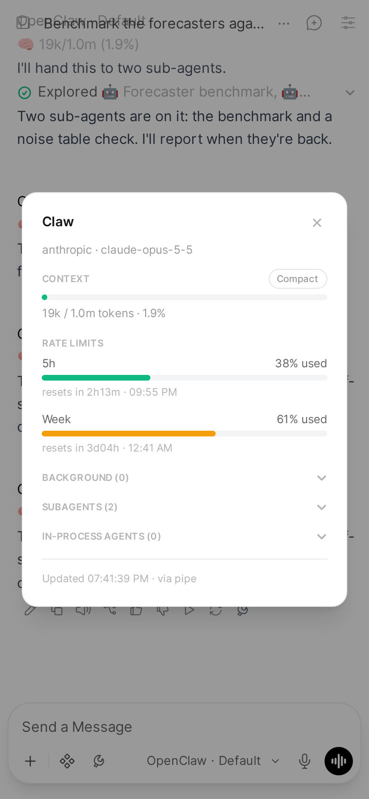
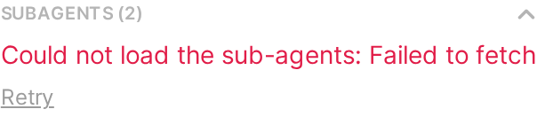
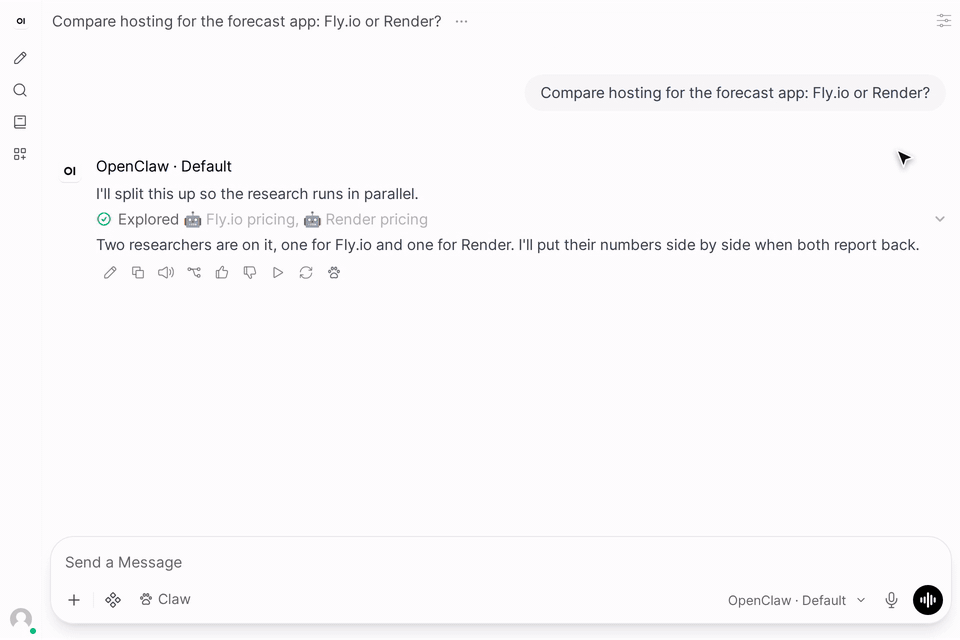
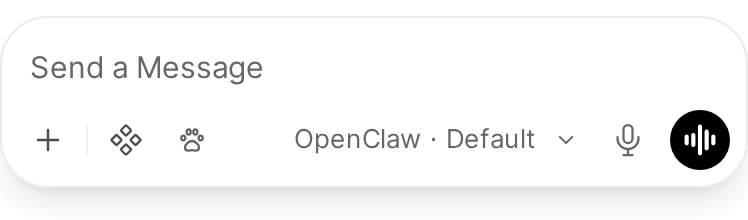

The Status dialog shows a chat's context use, your rate limits, what runs in the background for it and the sub-agents its runs spawned, fetched live when you open it. From there you can compact the session, or open any sub-agent's drawer to read its run like a chat.

Applies to: Action (the composer's Claw button also needs the Pipe)
Valves: `GATEWAY_URL`, `GATEWAY_TOKEN`, `DEVICE_IDENTITY`, `STATE_DIR`, `AGENT_ID`, `CONTROL_UI_URL` (Action); `COMPOSER_STATUS_BUTTON` (Pipe)

## The Status dialog

_Separate function: install the Status Action first, see [Status button](../install/status-action.md)._

_The rate limits in this screenshot are sample data._

The Status Action adds a button to the message toolbar. It opens a dialog, titled **Claw**, with five sections: Context, Rate limits, [Background](#background), [Subagents](#sub-agents) and In-process agents.

The dialog opens at once with every section's title. Each section then reads its own source and fills the moment that source answers, with its own loading, empty and error state, so a slow or failing source shows in its own section only:

_Here the rate limits were held back on purpose, to show it._

| Section | Reads |
|---|---|
| Context | `sessions.describe` |
| Rate limits | `usage.status`, for the provider Context's read names (the same request); `claudeCliUsage.status` only when `usage.status` has no windows |
| Background | `tasks.list` (OpenClaw 2026.9) or `sessions.processes.list` (2026.10), `cron.list`, and the chat's last 40 messages |
| Subagents | `sessions.list` with `spawnedBy` (the current children, store rows only) and the [child index](#sub-agents); the sub-agents' transcripts (`sessions.preview`) only once the section is open |
| In-process agents | The chat's last 40 messages (the same read as Background's) |

Each source is read once per open, all at the same time. None grows with the chat: the chat's messages come from Open WebUI's message rows, the 40 newest of the current branch, so a 14 MB chat opens as fast as a new one. Open WebUI saves a reply's tool cards only when the reply ends, so for a reply still running the sections take its calls from the Pipe streaming it, in the same Open WebUI process. Nothing is read while the dialog is closed: closing it tells the Action, which stops following its running sub-agents. In-process agents needs no Gateway, so it fills even when the Gateway cannot be reached.

Opening the dialog sends a small request, from the toolbar button or the composer's: the chat, the message and the model. Open WebUI's own handler for an Action button uploads every message of the branch first and saves the whole chat again after, which on a big chat over a phone connection takes seconds; the Claw button skips it. The model comes from the page script's delivery, else from the reply's own avatar. The script arrives within about a second of opening a chat; a click before that, or on a reply that is not on an OpenClaw model, goes through Open WebUI's handler as before.

Background, Subagents and In-process agents fold, with their count in the title, for example "Background (3)". Each opens when something in it is running and starts folded otherwise; a tap opens or folds it, and stays that way while the dialog is open. When the dialog is taller than the screen, its sections scroll between the title bar and the footer, which stay in view, on a phone too:

Usage bars are colour coded (green under 60%, amber from 60%, red from 85%), with the colours inlined so a theme cannot make them invisible.

The footer says when the dialog last refreshed and whether it used the Pipe's live connection (`via pipe`) or opened its own (`via action-own`). It reuses the Pipe's connection when one is open, and otherwise connects with the Pipe's saved device identity from `STATE_DIR`, so there is never a second device to approve. The Action's own connection only reads: it never writes a reply into a chat.

The Action's valves mirror the Pipe's (`install_action.py` copies them over): [`GATEWAY_URL`](../configuration.md#gateway_url-1), [`GATEWAY_TOKEN`](../configuration.md#gateway_token-1), [`DEVICE_IDENTITY`](../configuration.md#device_identity-1), [`STATE_DIR`](../configuration.md#state_dir-1), [`AGENT_ID`](../configuration.md#agent_id-1), under [Status Action](../configuration.md#status-action) in Configuration. Its own [`CONTROL_UI_URL`](../configuration.md#control_ui_url) is kept across re-installs: set it to the address you open the OpenClaw Control UI at (including any `gateway.controlUi.basePath`), and the dialog header links to this chat's session there, and the sub-agent drawer to the child's, each in a new tab, through the Control UI's short-id route `/chat/<agent>/<id>`. Empty (the default): no link.

## Rate limits

Rate limits come from the Gateway's `usage.status`. On a Gateway whose only Anthropic credential is a Claude CLI login, OpenClaw 2026.9.1 and later report no Anthropic windows there. The dialog then asks the optional [`gateway-plugins/claude-cli-usage`](../../gateway-plugins/claude-cli-usage) Gateway plugin, which serves the 5h and weekly windows read-only from the Claude CLI login. Without the plugin the section shows a note instead. Installing the plugin: [Status button](../install/status-action.md).

## Compact

A Compact pill in the dialog header runs `/compact` on the session. While it works, the dialog shows a distinct "Compacting..." state, then refreshes with the numbers after compaction.

Right after a compact, the context number can read far lower than what the next request carries: it counts the kept conversation, without the system prompt and tools. The next reply brings it up to date.

If the Gateway does not compact (the model refused the summary, say, or compaction is unavailable for the session), the Context section keeps its numbers and shows the Gateway's reason under them in red, for example "Compaction failed: Turn prefix summarization failed: 400 …". The `/compact` run ends as done either way, so the dialog reads the outcome from the run's own reply.

It waits up to 180 seconds, the same as the default timeout of `openclaw sessions compact`. If it takes longer, the dialog says so; compaction may still finish in the background.

While a reply is running, Compact refuses with "A response is currently in progress", rather than compacting the session under a running turn.

The `/compact` command becomes a turn in the session's stored transcript, so other tools that read that history see it, but it never appears as a message in the Open WebUI chat.

Typing `/compact` in the message box does not compact the session: Open WebUI 0.12 handles `/compact`, `/status`, `/fork` and `/model` itself, so they never reach OpenClaw. Use the Compact button in this dialog instead.

## Background

The Background section lists what runs for this chat outside a reply, running first, then the five newest that finished:

- **Commands** left running in the background (`exec` with `background`, or one that outlived its wait), named by the command the chat's tool card shows.
- **Image, Music and Video** jobs.
- **Automations** that run in this chat: whether one is running, its next run, and its last error when it failed ("Failed 3 times in a row: ...").
- **Agents**: Claude Code Agent calls started in the background, until the reply they hold open ends. A tap shows the task and the result, as under In-process agents.

Sub-agents are listed under Subagents, not here.

The section reads only when the dialog opens. OpenClaw 2026.10 removed the Gateway's task list (`tasks.list`): there the commands come from the session's process list (`sessions.processes.list`), with a finished one's last line of output under it, and media jobs are not listed (2026.10 has no per-chat list of them). A Gateway with neither list says background commands and media jobs are not available on it, and still lists the chat's automations.

While a background agent holds a reply open, the reply's status row says so, so the chat does not look busy for no reason:

It counts the background agents the reply started and stays until the reply ends.

## Sub-agents

The Subagents section lists every child session this chat's runs spawned, ended ones included, newest first, up to 20 ("20 of N" when there are more). A running one's elapsed time counts up while the dialog is open; one that finishes meanwhile shows its end as soon as the Gateway pushes the change. With none running, the section opens folded and reads the sub-agents' transcripts (their tasks and latest replies) on its first tap:

If that tap's request fails, for example when a phone loses its connection, the section says so and offers **Retry**.

The Gateway keeps an ended child in its children list for 30 minutes only, so the Pipe keeps a child index: each sub-agent it sees a chat spawn, and each one's last state as the dialog read it. It is one small file, `subagent-children.json` in the bridge state directory, so it survives restarts and redeploys; a chat untouched for 180 days is dropped from it, and each chat keeps its 200 newest children. Children spawned before the index existed are read in once, from one full list, the first time a dialog opens after the upgrade. A child spawned while the Pipe was not running shows while it runs and for 30 minutes after.

**In-process agents** lists the chat's Claude Code Agent calls, which are not Gateway sessions, as their tool cards show them: running, in the background, returned, cut off or failed. A chat longer than 40 messages shows the calls in its last 40, and says so.

Each row is one line: the sub-agent's spawn label (else the first sentence of its task, cut to 60 characters), its status, and its time, with up to two lines of its latest reply below. The whole task is in its drawer.

## Sub-agent drawer

Click a sub-agent to open its drawer: a side panel, or on a phone a full-screen sheet with a **‹ Back** button. The top is a short header: the sub-agent's name, its status and its time; its model and the chat it came from (a link; for a sub-agent spawned by another sub-agent, its parent's drawer); and the first two lines of its task, with "Show all". Shown whole, a long task scrolls in its own box of up to 40% of the screen, so the run below it and the close button stay in reach.

Below the header is the sub-agent's run as a read-only chat, oldest first: what it said, every tool call as a collapsed card (tap it for the input and the output; a failed one is marked ❌, as in the chat), any message it was sent after its task, and its reply last. The cards are the same ones the chat shows for a run, drawn from the same transcript the same way. There is no composer.

An in-process agent opens the same sheet: its task as the message that started it, and its result as the reply.

The drawer reads the sub-agent's whole transcript (`chat.history`). A very long run shows its newest steps and says how many earlier ones are left out, with **Show earlier steps** to read them too. While the sub-agent runs, the drawer refreshes about every 2.5 seconds, adds each new step and shows which step it is on ("Working… (step 3)"); if you scrolled up to read, it leaves you there. Closing it stops the refresh. When the steps show up depends on the runtime the sub-agent runs on:

- **OpenClaw's own runtime:** each step shows as it happens.
- **claude-cli runtime:** its messages and tool calls reach the transcript when its run ends, so while it runs the drawer says so and shows its latest line. A claude-cli sub-agent that is stopped before it ends keeps none of its tool calls, and the drawer says that too.

## Status button in the composer

The Pipe also adds a **Claw** button, with a paw, to the composer row of OpenClaw chats, right after the OpenClaw Thinking chip (or at the end of the composer's chips when that chip is off). It opens the same dialog through the Status Action, so the Action must be installed.

Open WebUI has no extension point for the composer, so the button is put into the page by JavaScript. If a future Open WebUI changes the composer and the anchor is not found, the button simply does not appear. It appears as soon as a tab opens an OpenClaw chat.

Turn it off with the Pipe's [`COMPOSER_STATUS_BUTTON`](../configuration.md#composer_status_button) valve. An already open tab keeps the button until you reload it.
