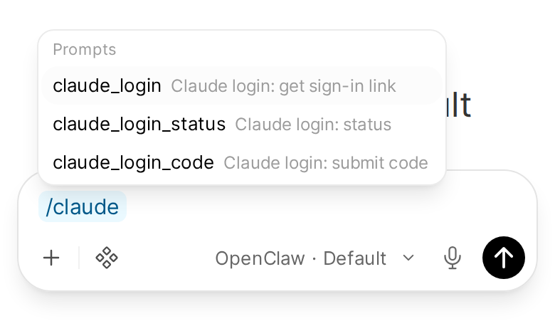

# Log in to Claude from chat (optional)

If your Gateway runs its Claude models on a Claude CLI login (`claude auth login`), that login runs out: its refresh token lasts about 30 days. When it does, the agent cannot answer, including the message that would ask it to fix the login. This optional Gateway plugin adds a `/claude_login` command that renews the login from any chat, Open WebUI included, without the model.

It is an add-on for that setup, not part of the Pipe. With an API key or another credential for your Claude models, you don't need it.

Applies to: Gateway plugin `gateway-plugins/claude-login`, three Open WebUI prompts

## What it does

`/claude_login` is a plugin command: the Gateway runs it itself, with no LLM turn, so it works while the model is logged out.

| You send | It does |
|---|---|
| `/claude_login` | Starts `claude auth login` on the Gateway host and replies with the sign-in link |
| `/claude_login <code>` | Passes the code from the sign-in page to that login, then replies with the result |
| `/claude_login status` | Who the CLI is logged in as, and when the login runs out |
| `/claude_login cancel` | Stops a login in progress |

A started login waits 10 minutes for its code. It lives in the Gateway process, so a Gateway restart in between drops it: send `/claude_login` again. Replies never contain a token, only the account email and the expiry date.

Renew a few days before the date `status` shows and the agent never goes down.

## Who can run it

The command needs the `operator.admin` scope, so only the Gateway's owner can run it. In Open WebUI that is every user while the Pipe's [`OWNER_USERS`](../configuration.md#owner_users) valve is empty, and only the users it lists once it is set. Other users' chats reach the Gateway without that scope, and the Gateway refuses the command. See [Owner users](../features/owner-users.md).

## Install

The plugin runs inside the Gateway, so it goes on the **Gateway host**, next to the `claude` CLI the Gateway uses. It also needs `script` (from util-linux), which gives the CLI the terminal it asks for.

1. Copy the [`gateway-plugins/claude-login`](../../gateway-plugins/claude-login) folder from this repo to a permanent place on the Gateway host.
2. Install it from that folder:

   ```bash
   openclaw plugins install --link --accept-capabilities /path/to/claude-login
   ```

   This adds the folder to `plugins.load.paths`, enables the plugin and writes its install record. The record matters: a folder that is only listed in `plugins.load.paths` shows as enabled in `openclaw plugins list`, but the Gateway skips it at startup.
3. Restart the Gateway.

Check that it loaded: `openclaw plugins inspect claude-login` says `Status: enabled` and `Trust: reason=origin-path`, and the Gateway's startup log lists `claude-login` among its plugins. Then send `/claude_login status` in a chat.

The plugin uses the Claude CLI's own config directory: `CLAUDE_CONFIG_DIR` when the Gateway has it set, `~/.claude` otherwise.

## Add the commands to Open WebUI's / menu

Open WebUI lists its Workspace Prompts in the composer's `/` menu, so three prompts make the command one pick away. They are in [`gateway-plugins/claude-login/open-webui-prompts.json`](../../gateway-plugins/claude-login/open-webui-prompts.json).

In Open WebUI, go to Workspace > Prompts, choose **Import JSON** among the page's actions and pick that file (an admin, or a user allowed to import prompts). You get:

- `/claude_login`: inserts `/claude_login ` to get the sign-in link.
- `/claude_login_code`: asks for the code in a small form, then inserts `/claude_login <code>`.
- `/claude_login_status`: inserts `/claude_login status`.



Imported prompts belong to the user who imports them. Share them in each prompt's access settings if another owner should see them too.

## Renew the login

1. Send `/claude_login` (or pick the first prompt). The reply has a sign-in link.
2. Open it, sign in with the Claude account the Gateway should use, and approve. The page shows a code.
3. Send `/claude_login <code>` (or pick the second prompt and paste the code). The reply says `Login complete.` and the new expiry date.

If the reply says the login did not complete, the code was wrong or too old: start again with `/claude_login`.
