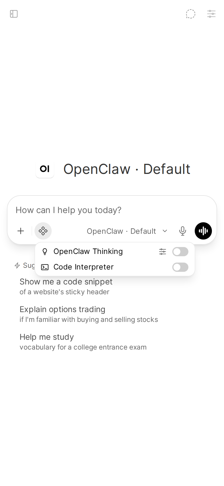

# Thinking control

The thinking filter adds a per-chat thinking control to the composer, so you can set how hard the agent thinks before answering, chat by chat. It is an optional, separate function: install it, then attach it to your OpenClaw models.

Applies to: Filter, Pipe

Valves: [`priority`](../configuration.md#priority), [`override_advanced_params`](../configuration.md#override_advanced_params), [`level`](../configuration.md#level) (per user)

## What you get

A thinking control in the composer's integrations menu:



Turn it on for a chat and pick a level in **Chat Controls** → **Valves**. The levels, what `default` and `off` mean, and how a level a model doesn't support is handled: [Chat](../features/chat.md).

## Install with the installer

It has its own installer, like the Status Action does. In the repo checkout:

```bash
uv run install_filter.py install   # create/update the Filter, ensure it's active, smoke test
uv run install_filter.py status    # inspect without changing anything
uv run install_filter.py repair    # same as install
```

It reads only `OWUI_URL`, `OWUI_EMAIL` and `OWUI_PASSWORD` (or `--owui-url`, `--owui-email`, `--owui-password`). There's nothing else to configure: unlike the Action it shares no valves with the Pipe, needs no device identity, and never talks to the Gateway itself.

What `install` does:

1. Log in to Open WebUI.
2. In a clone, rebuild `openclaw_thinking_filter.py` from `src/`.
3. Create the Filter function `openclaw_thinking`, or back it up to `backups/` and update it in place.
4. Make sure it is **Active**.
5. Smoke test: read the function back and check that Open WebUI has it as a filter, with exactly the code that was uploaded. A filter has no endpoint to trigger it, so this is the strongest check short of a real chat.

It deliberately does not touch **Global**: attach the filter per model instead (see below), since a global filter would write `reasoning_effort` into every chat with every model, including non-OpenClaw ones. If it finds the function already toggled global, it warns rather than silently turning that off.

`status` prints `function_exists`, `is_active`, `is_global` and `content_current` (the code in Open WebUI matches the file in your checkout). It exits 0 when the function exists, is active and is current.

Two differences from `install.py`, the same as `install_action.py`: it must be run from a clone (it imports from `install.py`), and it has no `healthcheck` subcommand.

## Install by hand

The equivalent manual steps, if you'd rather not run the installer:

1. Open WebUI → **Admin Panel** → **Functions** → **+** → **Create a function**.
2. Set the type to `filter` and the ID to `openclaw_thinking`.
3. Paste the contents of [`openclaw_thinking_filter.py`](../../openclaw_thinking_filter.py).
4. Save, then toggle it **Active**. Leave **Global** off unless every model you use is an OpenClaw model.
5. Attach it to your OpenClaw models (next section).

The filter imports nothing but the standard library and pydantic, so it needs no extra Python packages.

## Attach it to your OpenClaw models

In Open WebUI, for each OpenClaw model you want the control on: **Workspace** → **Models** → (model) → **Filters**, then tick the filter and save.

A global filter runs on every chat with every model, and this one writes `reasoning_effort`, which other pipes may interpret differently. That is why both the installer and the manual steps leave **Global** off.

## It does nothing until you switch it on

Once active, it does nothing until you switch the toggle on in a given conversation. Open WebUI does not run a toggled filter's `inlet` while the toggle is off, so an untouched chat behaves exactly as if the filter were not installed.

Picking another model in the chat switches the toggle off again: Open WebUI resets the composer's toggles (filters, tools, web search) on every model change and keeps only the new model's defaults. Switch it back on after a model change.

## Show your models' real levels

The Pipe should be installed first. The filter's level dropdown is filled from a cache the Pipe writes, `STATE_DIR/thinking-ladders.json`, with the levels it has seen your models support. Before the Pipe has run once, the dropdown falls back to the five levels every observed provider supports: `off`, `minimal`, `low`, `medium`, `high`.

 Valves" width="320">

The dropdown is baked in when Open WebUI loads the filter. So after the Pipe has completed a first chat with a given model, reload or re-save the filter function (**Admin Panel** → **Functions** → `openclaw_thinking` → **Save**) to pick up the real levels. Otherwise it keeps showing the fallback list until the next reload.

The filter looks for the cache in the `OPENCLAW_BRIDGE_STATE_DIR` environment variable of the Open WebUI container, or `/data/openclaw-bridge`. It does not read the Pipe's `STATE_DIR` valve. If you set the Pipe's `STATE_DIR` to another directory, set `OPENCLAW_BRIDGE_STATE_DIR` to the same path, or the dropdown stays on the fallback list.

## Valves

- [`priority`](../configuration.md#priority): filter execution order, lower runs earlier (default `0`).
- [`override_advanced_params`](../configuration.md#override_advanced_params): on by default. Decides who wins when both this filter and Open WebUI's own Advanced Params reasoning effort are set; turn it off to let Advanced Params own the value and use the toggle only to enable thinking.
- [`level`](../configuration.md#level): a per-user valve, the level you pick in **Chat Controls** → **Valves**.

## Uninstalling

Delete `openclaw_thinking` in **Admin Panel** → **Functions**. See [update and uninstall](./update-uninstall.md).
