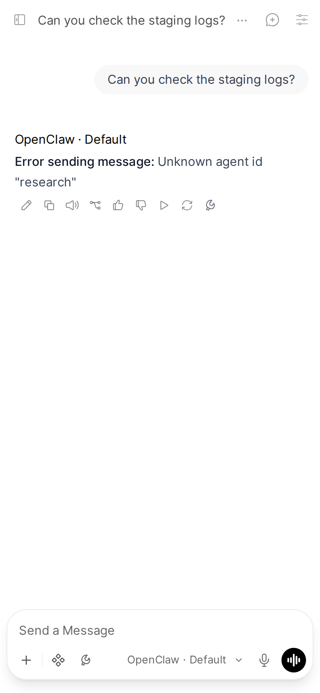

# Troubleshooting

Something not working? Find your symptom or the error in the chat below, then check the Open WebUI backend log for `[openclaw-pipe]` lines. If you still need help, the last section says what to put in a bug report.

Applies to: Pipe, Action, Filter
Valves: `GATEWAY_URL`, `GATEWAY_TOKEN`, `AGENT_ID`, `STATE_DIR`, `DEVICE_IDENTITY`, `MAX_MODELS`, `USE_OWUI_FILES`, `OWUI_BASE_URL`, `OWUI_API_KEY`, `TITLE_GEN_AGENT_ID`

## Start with the healthcheck

The installer can check the install for you, fix the common problems and run an end-to-end smoke test.

In the repo checkout:

```bash
uv run install.py status        # what is installed: is the function active, global and listed
uv run install.py repair        # re-run the install steps on the existing function, then the smoke tests
uv run install.py healthcheck   # status plus the smoke tests, without reinstalling
```

More on these commands: [The installer](./install/installer.md).

## Symptoms

| Symptom | Likely cause and fix |
|---|---|
| "The GATEWAY_TOKEN valve is empty" | The valve is not set. In Open WebUI, go to Admin Panel > Functions > OpenClaw Gateway > valves and set [`GATEWAY_TOKEN`](./configuration.md#gateway_token) to the value of `gateway.auth.token` in your OpenClaw config. |
| A "**Gateway connection error:**" line instead of a reply | Open WebUI cannot reach [`GATEWAY_URL`](./configuration.md#gateway_url). The Open WebUI backend makes this connection, not your browser, so check the network from the Open WebUI host or container. |
| A model is missing from the model picker | Run `uv run install.py repair`: it makes sure the function is active, global and listed in `/api/v1/models`. Also check that [`MAX_MODELS`](./configuration.md#max_models) (default `30`) is not capping the list. |
| "pairing required", or "not an approved device" | Run `uv run install.py repair`, or approve the request on the Gateway host with `openclaw devices approve <request-id>`. See [Device pairing](./install/pairing.md). |
| Repeated device-pairing prompts | `STATE_DIR` is not persistent. Grep the backend log for `STATE_DIR unavailable`: the Pipe then uses `/tmp/openclaw-bridge`, which a container restart wipes. Point [`STATE_DIR`](./configuration.md#state_dir) at a persistent volume. |
| The agent stops answering after about a month, and the Gateway log has `OAuth session expired` or `Not logged in` | Its Claude models run on a Claude CLI login, which lasts about 30 days. Log in again with `claude auth login` on the Gateway host, or from any chat with the optional [`/claude_login` plugin](./install/claude-login.md). |
| Device identity not persisting | Check [`STATE_DIR`](./configuration.md#state_dir) and the [`DEVICE_IDENTITY`](./configuration.md#device_identity) valve, then run `uv run install.py healthcheck`. |
| `ModuleNotFoundError: websockets` when the function loads | Open WebUI's frontmatter auto-install is off (`ENABLE_PIP_INSTALL_FRONTMATTER_REQUIREMENTS=false`) or it runs in `OFFLINE_MODE`. Install `websockets` and `cryptography` into the Open WebUI image yourself. |
| Models are listed as "-- example, Gateway not reached" | The Pipe has not reached your Gateway yet, so the picker shows a built-in example list instead of your models. Pick `OpenClaw · Default` (it always works), send one message to connect, then reload: the real list replaces it. If it persists, the Gateway is unreachable: check `GATEWAY_URL` and `GATEWAY_TOKEN`. |
| "Could not start a session on agent `<id>`" | [`AGENT_ID`](./configuration.md#agent_id) names an agent your Gateway does not define. Use `main` unless you configured others. |
| Tool calls not showing | The calls that draw tool cards fail silently. Check the backend log, and that Open WebUI is at least the minimum in [Versions](./versions.md). |
| An image link points at port 18791 instead of being attached | The upload to Open WebUI's Files API failed and the Pipe fell back to its own file server. The log says `OWUI file upload failed; falling back`. Check [`OWUI_BASE_URL`](./configuration.md#owui_base_url), the request's login or [`OWUI_API_KEY`](./configuration.md#owui_api_key), and the Open WebUI log. See also [Security](./security.md#the-media-file-server). |
| A reply goes quiet for a long time | The Pipe has no silence timeout: a quiet reply is usually a long tool call or the model thinking. The reply ends when the run ends, fails or is stopped. If the page stopped updating, reload: the partial answer is kept. Check the backend log for the turn. See [Reliability](./features/reliability.md). |
| The answer stops after a Gateway restart | The Pipe resumes a reply cut off by a Gateway restart, up to 3 times per reply. After that the reply ends with a "cut off" note: the Gateway was down too long or kept restarting. Send the message again. |
| A typed `/compact`, `/status`, `/fork` or `/model` does nothing in OpenClaw | Open WebUI 0.12 handles these commands itself, so they never reach OpenClaw. To compact the session, use the Compact button in the [Status dialog](./features/status.md#compact). |
| Chats never get a title | [`TITLE_GEN_AGENT_ID`](./configuration.md#title_gen_agent_id) (default `title-gen`) must name an agent your Gateway defines. If it does not, titles are skipped without an error. |

## Errors in the chat

Failures name the thing that fixes them. When the cause is genuinely ambiguous, the message says so instead of guessing.



| The chat shows | What to do |
|---|---|
| "This Open WebUI instance is not an approved device on the OpenClaw Gateway yet", with this device's id | On the Gateway host, run `openclaw devices list`, then `openclaw devices approve <request-id>` for the request with that id. Then send your message again. |
| "The Gateway rejected the credentials" | [`GATEWAY_TOKEN`](./configuration.md#gateway_token) must match `gateway.auth.token` in your OpenClaw config. |
| "The GATEWAY_URL valve is empty", or "GATEWAY_URL has an unsupported scheme" | Set [`GATEWAY_URL`](./configuration.md#gateway_url) to a bare `host:port`, for example `localhost:18789`. A pasted `http://`, `https://`, `ws://` or `wss://` prefix is accepted and stripped; any other prefix is not. |
| "No response from the OpenClaw Gateway at `<host:port>` within 10s", or "Could not connect to the OpenClaw Gateway at `<host:port>`" | Check `GATEWAY_URL`, that the Gateway is running, and that the Open WebUI backend can reach that host. |
| `Error sending message: Agent "<id>" no longer exists in configuration` (the screenshot above) | [`AGENT_ID`](./configuration.md#agent_id) names an agent your Gateway does not define. Use `main` unless you configured others. |
| "Could not start a session on agent `<id>`" | Fix [`AGENT_ID`](./configuration.md#agent_id). The model may be fine: applying the model is just the first thing the Pipe asks the agent to do. |
| "Model selection error: could not apply `<model>`" | The Gateway refused that model. Pick another one, or check [`DEFAULT_MODEL`](./configuration.md#default_model). |
| "Could not start this conversation's session" | The cause is unclear. Check that `AGENT_ID` names an agent your Gateway defines and that the model is one it offers. |
| "The Gateway did not respond in time while starting this conversation" | Usually transient: send the message again. If it keeps happening, check that the Gateway is healthy and reachable from Open WebUI. |
| "Timeout: Gateway did not respond to chat.send", or "Error sending message" | The Gateway did not accept the message. Send it again; if it repeats, check the Gateway's own log. |
| "Error:" followed by a message | The run failed on the Gateway, and the text after "Error:" is the Gateway's own error. |
| "Failed: the run did not complete." | The run failed and the Gateway gave no reason. Check the Gateway's log. |
| "This reply was cut off: the run was interrupted again after 3 attempts to continue it." | See "The answer stops after a Gateway restart" above. |

## Where the logs are

Every turn logs to the Open WebUI backend log (its standard output), each line prefixed with `[openclaw-pipe]`. The Status Action logs with the same prefix. The thinking filter does not log.

One reply in the Pipe's log (an excerpt):

```text
[openclaw-pipe] Messages: 1, last role: user
[openclaw-pipe] Session key: agent:main:openwebui-<user id>-<chat id>
[openclaw-pipe] Cleared model override; using agent default
[openclaw-pipe] Captured runId: msg-<chat id>-<message id>-1792018617.1007752
[openclaw-pipe]   Tool start: exec
[openclaw-pipe]   Item: kind=tool status=running title=exec Commits from the last week
[openclaw-pipe]   Tool result: exec (200 chars)
[openclaw-pipe]   Item: kind=tool status=completed title=exec Commits from the last week
[openclaw-pipe]   Tool start: read
[openclaw-pipe]   Item: kind=tool status=running title=read from forecast/CHANGELOG.md
[openclaw-pipe]   Tool result: read (273 chars)
[openclaw-pipe]   Item: kind=tool status=completed title=read from forecast/CHANGELOG.md
[openclaw-pipe]   lifecycle end -> done
[openclaw-pipe] DONE -- 129 events processed, text yielded: True
```

On the Open WebUI host, with Docker (the container name depends on your deployment):

```bash
docker logs --since 30m open-webui 2>&1 | grep '\[openclaw-pipe\]'
```

What you will find there, always on and not configurable:

- for every turn: the session key, the run id, the event count, and tool starts and results;
- a turn that produced no text at all, marked `[diag] PHANTOM (no text)`;
- `STATE_DIR unavailable`, when the Pipe fell back to `/tmp/openclaw-bridge`;
- `OWUI file upload failed; falling back`, when an attachment went to the file server instead;
- `resumed as ...`, with a count out of 3, when a reply continued after a Gateway restart.

## What to put in a bug report

Open an issue at [github.com/Eliav2/openclaw-openwebui-integration/issues](https://github.com/Eliav2/openclaw-openwebui-integration/issues) with:

1. **Versions:** Open WebUI, OpenClaw, and the function's version (Admin Panel > Functions, or the `version:` line at the top of `openclaw_pipe.py`). Check them against [Versions](./versions.md) first.
2. **Setup:** one host or two ([two hosts](./install/two-hosts.md)), and which functions you installed (Pipe, Status Action, thinking filter).
3. **What happened:** what you did, what you expected, what you saw. A screenshot helps.
4. **The healthcheck output:** `uv run install.py healthcheck`.
5. **The log lines:** the `[openclaw-pipe]` lines for the failing turn, and the Gateway's log around the same time.

Before you paste anything, remove secrets: never include `GATEWAY_TOKEN`, `DEVICE_IDENTITY`, `OWUI_API_KEY`, `.pipe_device_identity.json` or anything from `backups/`. See [Security](./security.md#secrets).

For a security problem, do not open a public issue: report it privately as [SECURITY.md](../SECURITY.md) describes.
